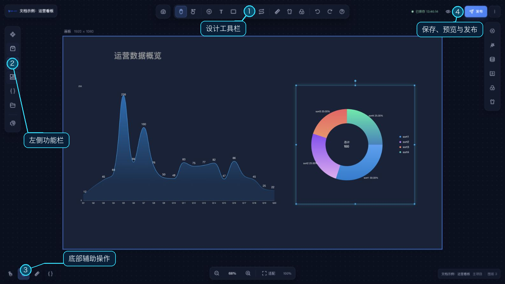

# LIGHT CHASER PRO 文档

## 前言

感谢关注和使用 LIGHT CHASER PRO。

LIGHT CHASER PRO 是一套面向大屏、数据看板和交互页面的可视化产品。本指南的功能说明以 **Web 端**为准：在浏览器中登录，完成项目设计、数据接入、资源管理、AI 辅助编辑和发布。

本次文档按 Web 工程 `2026.9.0` 的代码及实际页面核对（2026-10-18）。截图使用文档示例项目，图表数据仅用于展示操作，均为 16:9。

Web 端由 `lcp-server` 同时提供页面、接口和资源。桌面安装包与独立运行时属于另外的交付方式，保留在部署章节供对应版本查阅，不作为 Web 功能依据。

如果在使用过程中遇到问题，可以通过页面中的帮助入口或作者联系方式获取支持。

你可以通过以下方式联系到作者：

- 邮箱：1182810784@qq.com
- 微信：P2016137144
- QQ：1182810784

## 主要入口

- [快速开始](/quick_start/quick_start.md)
- [功能介绍](/functions/functions.md)
- [产品介绍](/introduce.md)
- [Web 端部署](/deploy/web.md)
- [源码开发启动](/start.md)

## 相关链接

#### 项目仓库

- [Web 工程](https://github.com/xiaopujun/lcp-web)
- [桌面端工程](https://github.com/xiaopujun/lcp-desktop)

#### 社交媒体

- [哔哩哔哩](https://space.bilibili.com/29136350?spm_id_from=333.1007.0.0)
- [抖音](https://www.douyin.com/user/MS4wLjABAAAAFidKgCHz-sAX6fJAAzBjFFbg6sVdS7IN3lYc2-qJA_Q)

#### 在线体验

- [LIGHT CHASER PRO 在线体验](http://www.lcdesigner.cn/home/server)

## 实机演示

#### 共享充电数据看板

    

         <iframe src="//player.bilibili.com/player.html?isOutside=true&aid=1404789749&bvid=BV1Cr421j7Xs&cid=1551785121&p=1&autoplay=0" scrolling="no" border="0" frameborder="no" style="width: 100%; height: 100%;" framespacing="0" allowfullscreen="true"></iframe>
    

#### 机场动态数据看板

    

         <iframe src="//player.bilibili.com/player.html?isOutside=true&aid=1653746118&bvid=BV1NE421j7ai&cid=1518069867&p=1&autoplay=0" scrolling="no" border="0" frameborder="no" style="width: 100%; height: 100%;" framespacing="0" allowfullscreen="true"></iframe>
    

