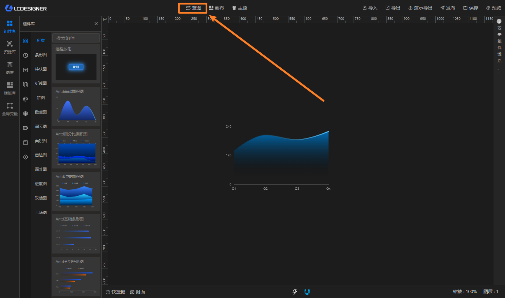

# 蓝图

蓝图编辑器用于把组件事件、数据变化和功能逻辑连起来，做出页面联动效果。

你可以把它理解成一张“联动流程图”：

- 图层节点对应画布上的组件
- 功能节点负责条件判断、逻辑处理、网络连接、定时触发和弹框
- 全局变量节点负责把全局变量接入蓝图

## 左侧节点区

蓝图左侧会分成三个分类：

- 图层节点：来自当前画布上的组件
- 功能节点：条件判断、逻辑处理、显隐、WebSocket、MQTT、定时器和弹框
- 全局变量：已经创建好的全局变量节点

## 底部页面区

蓝图支持多个子页面，每个页面都有自己独立的节点、连线和配置，适合把复杂逻辑拆开管理。
