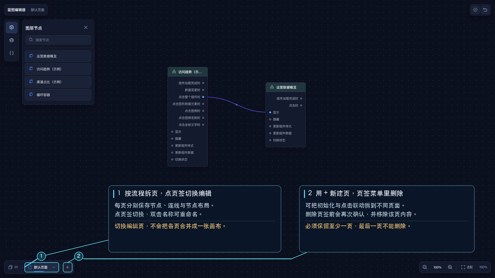

# 蓝图页面

蓝图可以拆成多个页面管理。每个页面分别保存自己的节点、连线和节点布局，切换页面不会把它们合并到同一张画布。

## 页面操作

- 点击底部页面标签切换页面。
- 双击页面标签，或打开当前页签的操作菜单后选择“重命名”。
- 点击底部 `+` 新建页面。
- 打开当前页签的操作菜单并选择“删除页面”，确认后删除。
- 页面较多时，点击左下角的页面总览按钮，从菜单中选择其他页面。

删除页面前会再次确认；至少保留一个页面，最后一个页面不能删除。

## 何时拆分页面

- 把初始化流程与用户交互流程分开。
- 把不同业务场景分开。
- 某段流程过长时，拆到独立页面便于查找和维护。
