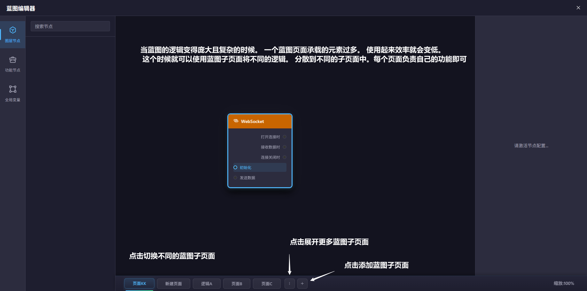

# 蓝图子页面

蓝图支持多个子页面，每个页面会保存自己独立的节点、连线和配置。适合把不同业务阶段拆开管理。

## 常用操作

- 点击底部页签切换页面
- 双击页签重命名
- 点击 `+` 新建页面
- 点击页签上的 `×` 删除页面
- 子页面很多时，可以从更多菜单里找到被折叠的页签

## 什么时候该拆页

- 页面初始化和交互流程分开
- 不同业务场景分开
- 某一部分逻辑太长时，拆到新页面更容易维护

!> 至少需要保留一个蓝图子页面，删除最后一个页面时系统会阻止操作。
