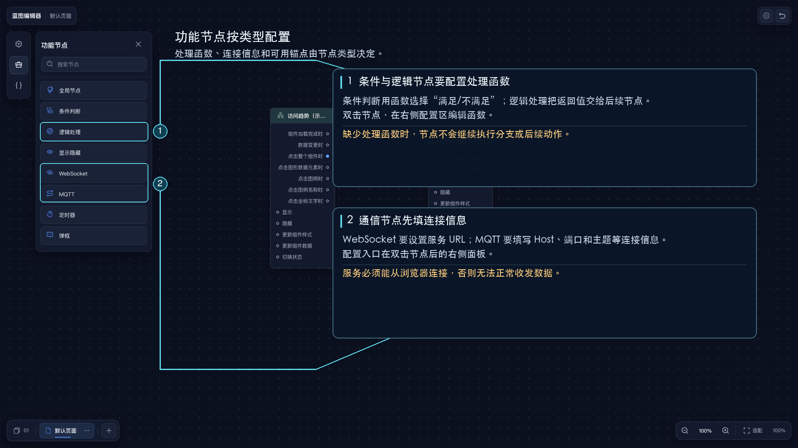

# 功能节点

功能节点在蓝图中处理分支、数据、通信和页面展示。拖入节点后，双击它打开右侧配置面板；每种节点只显示自己支持的锚点和参数。

## 当前节点

| 节点 | 锚点与行为 |
| --- | --- |
| 全局节点 | 无输入；所有组件加载完成时输出一次，适合触发初始化流程 |
| 条件判断 | 输入“判断”；按条件结果连接“满足”或“不满足”分支 |
| 逻辑处理 | 输入“执行”；运行配置的处理函数，并从“执行后”继续传递返回值。同步值和 `Promise` 结果都会继续传递 |
| 显示隐藏 | 输入“切换显隐”；在配置区指定控制范围，传入一个组件 ID 或 ID 数组以显示相应组件 |
| WebSocket | 输入“初始化”“发送数据”；输出“打开连接时”“接收数据时”“连接关闭时” |
| MQTT | 输入“订阅主题”“发送数据”；输出“打开连接时”“接收数据时”“连接关闭时” |
| 定时器 | 输出“定时执行”；按节点配置的间隔持续触发 |
| 弹框 | 输入“打开”；按节点配置展示指定的画布组件 |

## 使用要点

- 条件判断与逻辑处理需要在右侧配置区编写处理函数。条件判断选择一个分支；逻辑处理把返回值传给后续节点。
- 显示隐藏节点先在配置区选择需要控制的组件。连线传入组件 ID（字符串）或多个 ID（数组）以指定显示对象。
- WebSocket 与 MQTT 节点需要配置浏览器可连接的服务地址及协议参数；服务无法连接时，不能正常收发业务数据，应检查地址、协议和网络。
- 定时器和弹框没有通用的“执行后”输出锚点，按各自的锚点连接即可。

更完整的节点关系和锚点可在[蓝图总览](/functions/blue_print/blue_print.md)中查看。
