# 功能节点

功能节点用于处理蓝图里的通用逻辑，不直接绑定画布上的具体组件。它们更适合做条件分支、数据加工、网络连接、定时触发和弹框展示。

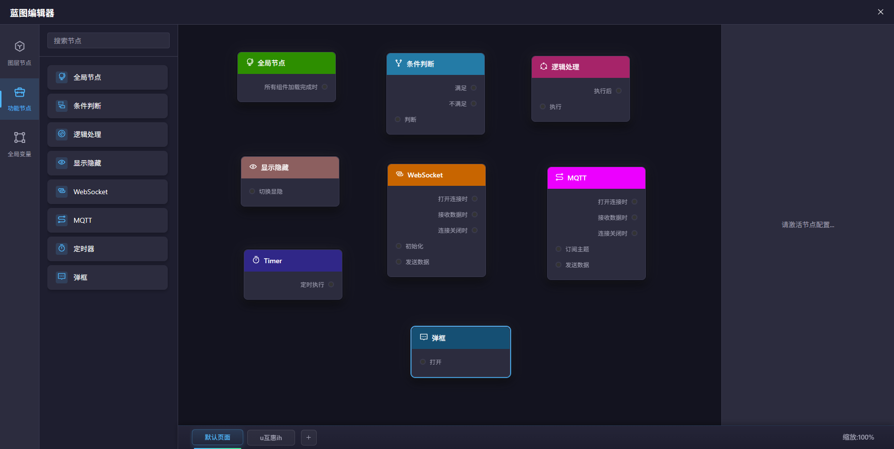

## 全局节点

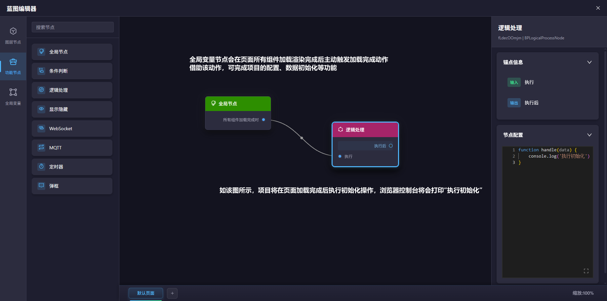

全局节点会在所有组件加载完成后触发一次，适合做页面初始化类联动。

## 条件判断节点

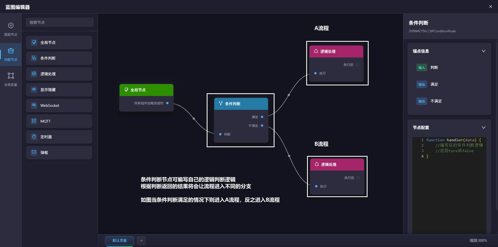

条件判断节点会根据你填写的判断逻辑，把流程分到“满足”和“不满足”两个分支。

## 逻辑处理节点

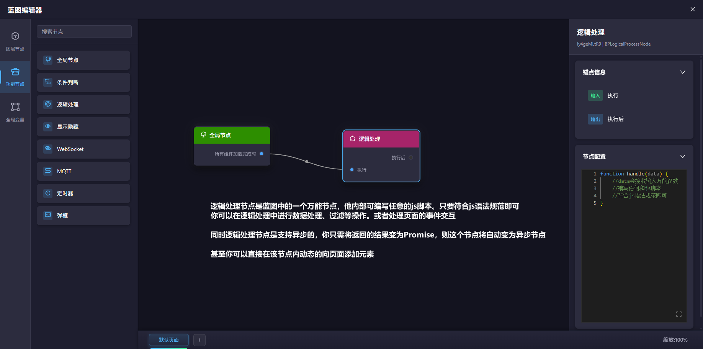

逻辑处理节点适合做自定义数据处理。它可以返回同步结果，也可以返回 `Promise` 结果再继续往下传。

## 显示隐藏节点

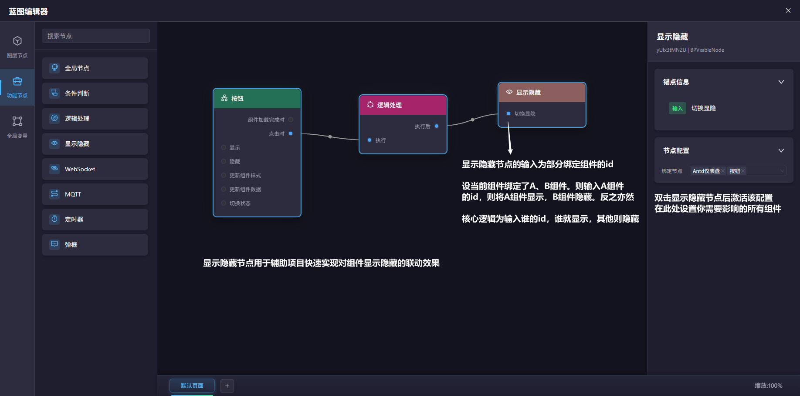

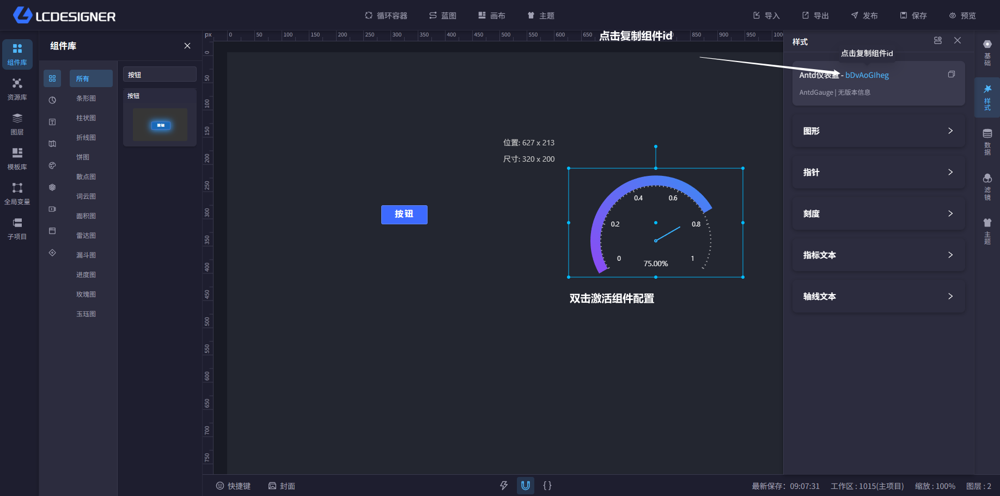

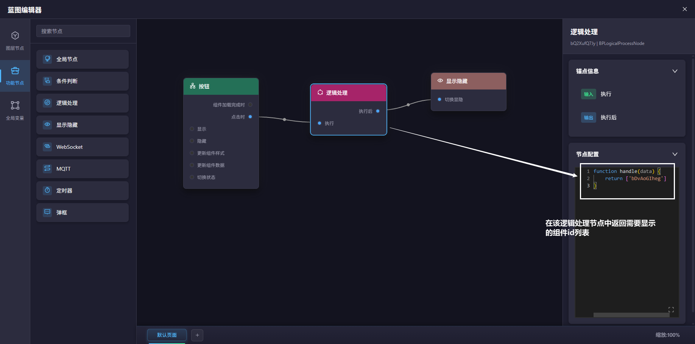

显示隐藏节点用于批量控制组件显隐。你先在右侧选择要绑定的节点，再把组件 id 或 id 列表传进来，就能切换对应组件的显示状态。

## WebSocket 节点

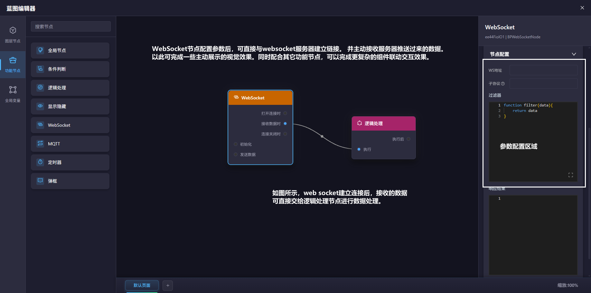

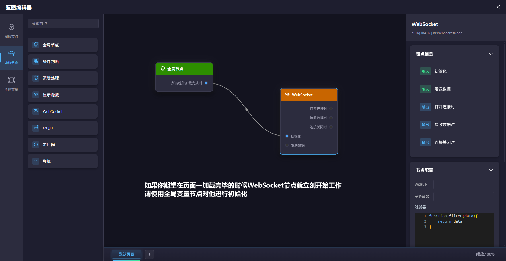

WebSocket 节点用于建立 WebSocket 连接、发送数据和接收消息。常见场景是实时数据推送或长连接通信。

## MQTT 节点

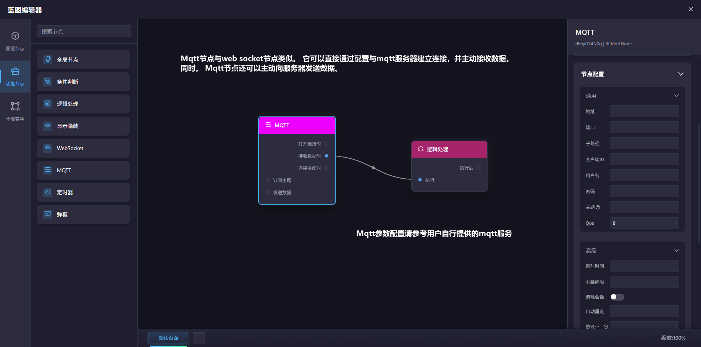

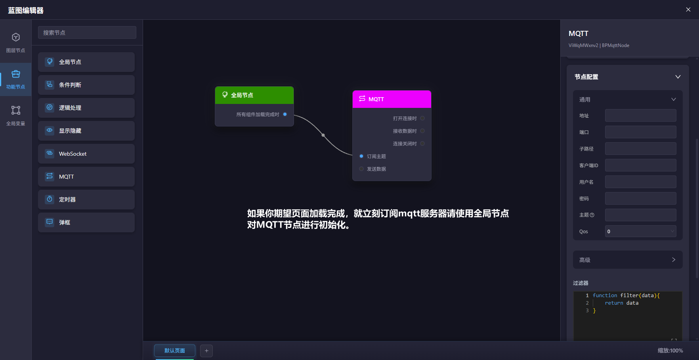

MQTT 节点用于连接 MQTT 服务、订阅主题和发送消息。常见场景是物联网设备联动或消息订阅。

## 定时器节点

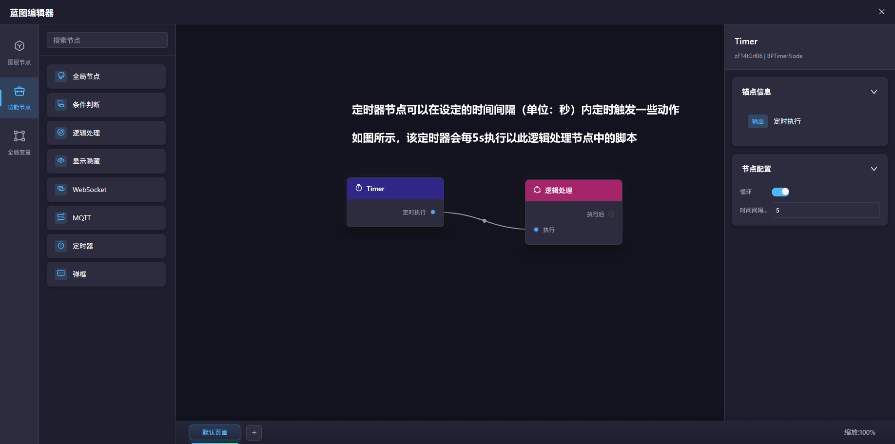

定时器节点可以按配置的时间间隔持续触发，适合做轮询刷新或周期性联动。

## 弹框节点

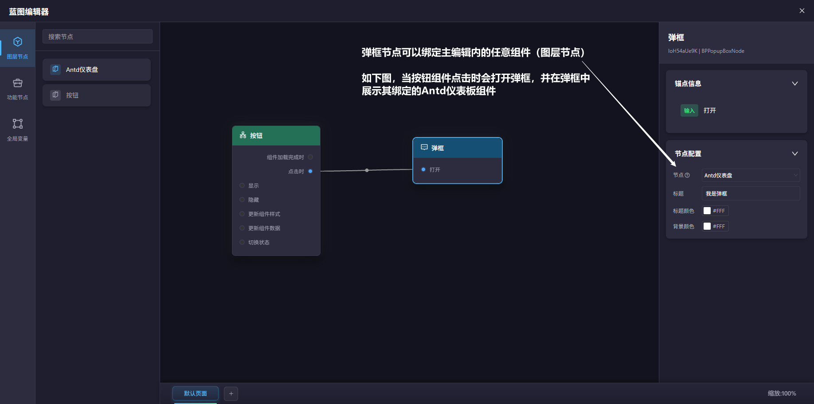

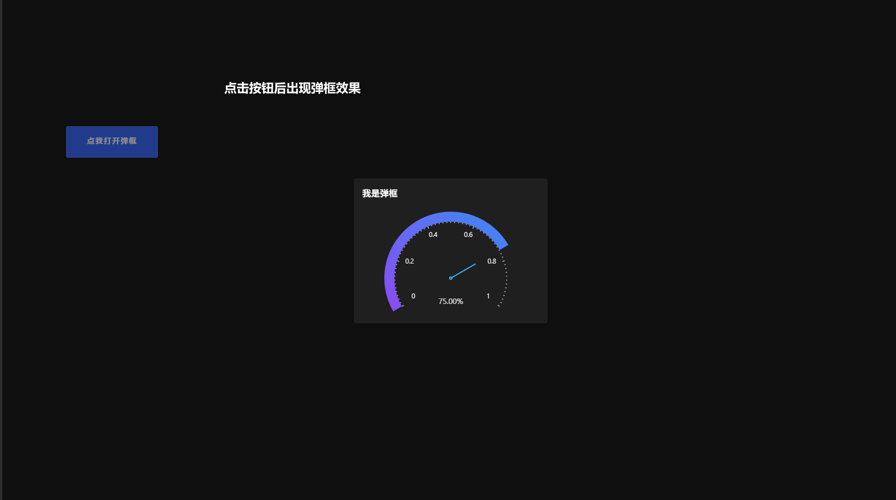

弹框节点会把指定节点以弹框形式展示出来，适合做详情查看、局部展开或临时交互。
