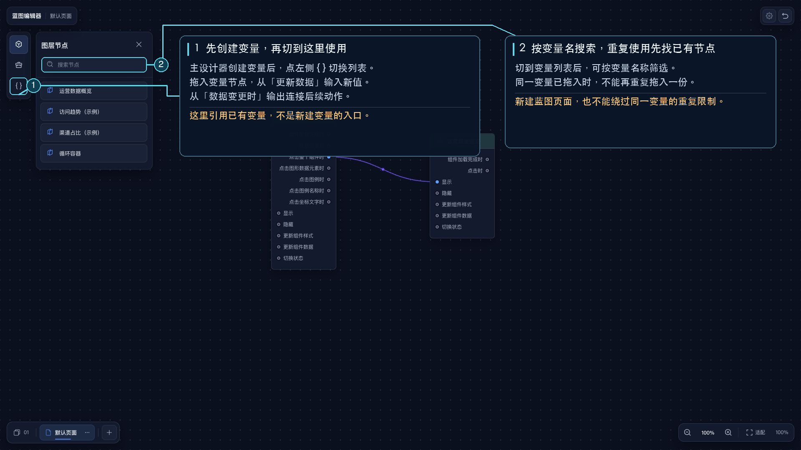

# 全局变量

蓝图里的全局变量节点来自主设计器中的 [全局变量](/functions/main_desiner/global_variable.md)。

## 怎么用

1. 先在主设计器里创建全局变量
2. 回到蓝图中切换到 `全局变量`
3. 把对应变量拖到画布上
4. 从 `更新数据` 输入锚点传入新值
5. 从 `数据变更时` 输出继续连接后续节点

## 能做什么

- 从蓝图中更新全局变量值
- 当全局变量变化时，继续触发后续节点联动

## 使用提醒

- 如果还没有创建全局变量，蓝图里不会出现对应的变量节点
- 全局变量节点通常只拖一次，重复使用会被限制
