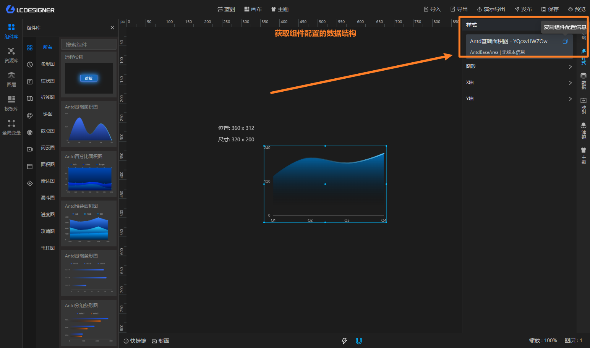

# 图层节点

图层节点来自主设计器画布上的组件。你把组件拖到画布中后，蓝图里就会出现对应的图层节点。

图层节点和画布组件是一一对应的，组件在画布上的变化，也会反映到蓝图节点里。

## 你会看到什么

- 输入锚点：对应组件可以执行的动作
- 输出锚点：对应组件会触发的事件

## 怎么用

1. 先在主设计器里把组件放到画布上
2. 回到蓝图，左侧就会出现对应的图层节点
3. 把其他节点连到输入锚点，驱动组件动作
4. 把组件输出锚点连到后续节点，继续联动

## 常见场景

- 点击按钮后修改文本
- 组件加载后执行初始化
- 根据组件事件切换显隐或弹框

> 图层节点通常会和组件的数据结构一起使用，双击组件或节点配置时可以查看更详细的参数。
