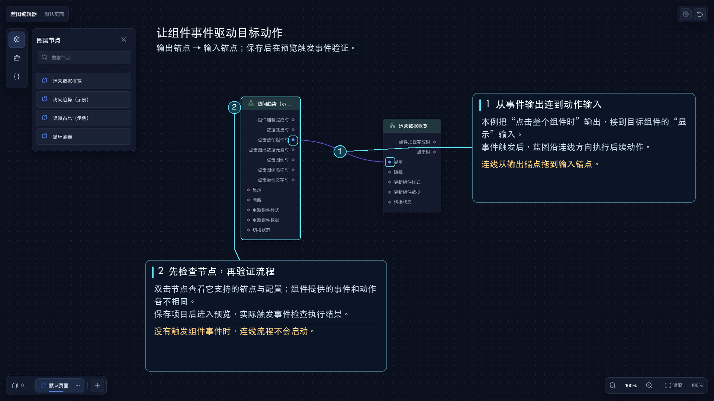

# 蓝图使用流程

1. 在主设计器中创建要参与联动的组件或全局变量。
2. 打开蓝图，并选择需要编辑的页面。
3. 在左侧选择“图层节点”“功能节点”或“全局变量”，搜索后拖到画布。
4. 从输出锚点拖线到输入锚点，建立执行顺序。
5. 双击节点，在右侧检查锚点并填写节点配置。
6. 保存项目后进入预览，触发事件并检查结果。

通常由图层节点发出组件事件，功能节点完成判断或处理，再调用图层节点动作；全局变量节点可读写变量并在变量变化时触发后续流程。

## 排查顺序

- 找不到图层节点：先确认该组件已放到主设计器画布中。
- 找不到全局变量：先在主设计器创建变量。
- 连线失败：确认输出锚点连接的是输入锚点，并检查当前节点实际支持的锚点。
- 预览时没有执行：确认项目已保存，触发事件的组件确实会发出该事件，并检查条件判断的结果。

图层节点和全局变量节点通常各只有一个实例；重复拖入时会被限制。需要拆分流程时可新建[蓝图页面](/functions/blue_print/bp_sub_page.md)。
