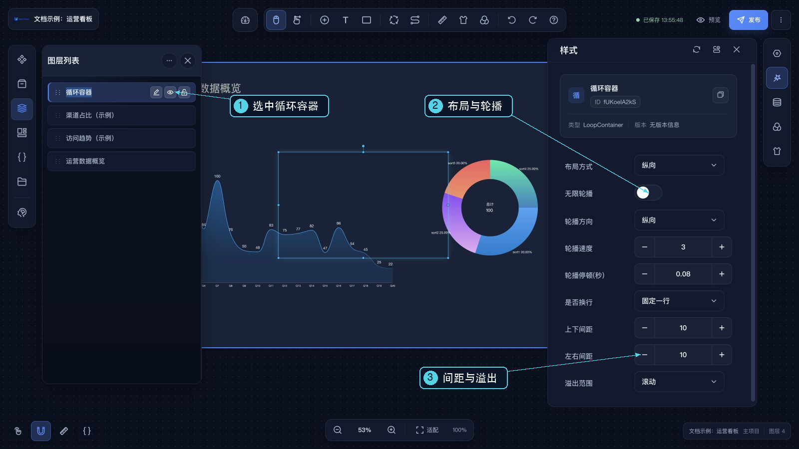
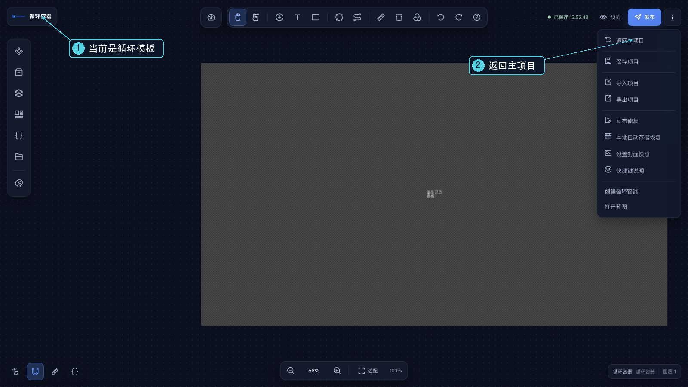

# 循环容器

循环容器把一份子组件布局作为模板，按数据数组中的每一项重复渲染。它适合展示列表、指标卡片或重复的数据项；容器负责重复和排布，文字、图标、数值等内容仍由内部组件呈现。

## 创建并编辑模板

1. 在主设计器中添加“循环容器”。
2. 为循环容器设置数据源，并确认最终数据是数组。
3. 选中循环容器，右键组件或其图层，在菜单中选择“循环容器”，进入其内部画布。
4. 在内部画布添加要重复显示的组件，配置好位置和样式。
5. 为内部组件设置静态样例数据，然后从右上角 **更多项目操作 → 返回主项目**返回，再保存整个项目。
6. 在预览中检查每条数据是否按模板重复显示。

## 数据规则

循环容器本身可以使用设计器提供的数据源配置；运行时结果必须是数组，数组中每一项对应一份模板实例。数据不是数组时，循环容器不会按预期渲染。

编辑内部模板时，内部组件的数据配置仅开放静态数据。设计器会用循环数据第一项作为编辑样例，方便配置字段映射；预览时再将每一项数据同步到对应的内部组件。

## 排列与轮播

循环容器的“样式”配置可设置：

- 布局方式：横向或纵向。
- 横向和纵向间距。
- 是否换行。
- 溢出区域：隐藏或滚动。
- 无限轮播：启用后可选轮播方向、速度和每轮停顿秒数。

轮播只在运行预览/发布时生效，并且至少需要两条数据；编辑模板时不会自动轮播。

## 蓝图联动

循环容器可触发“组件加载完成时”和“点击时”事件，也可接受显示、隐藏和更新组件数据动作。通过“更新组件数据”传入新数组，可以替换当前列表数据。
