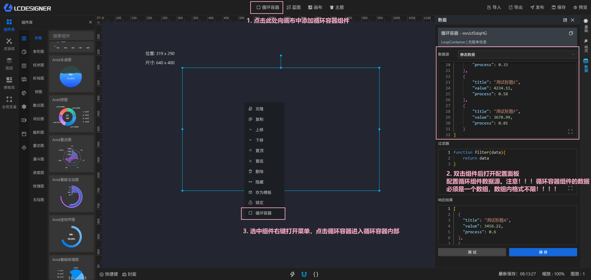
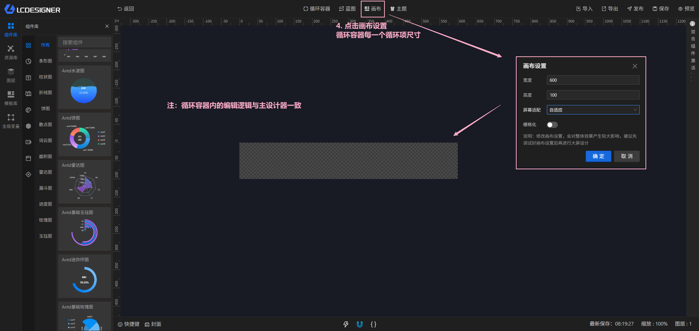
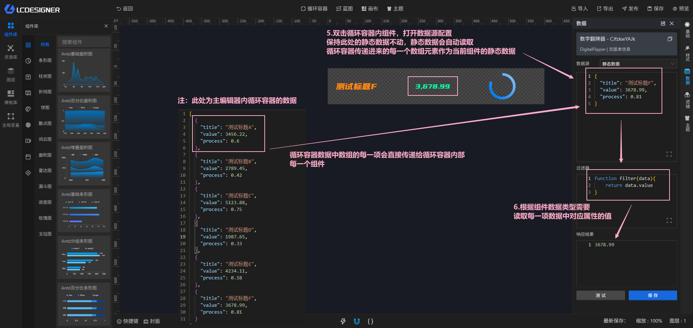
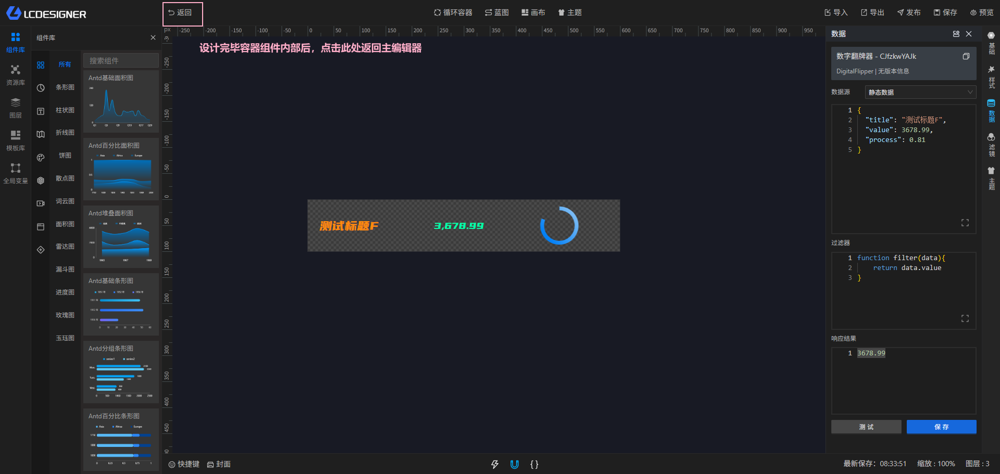
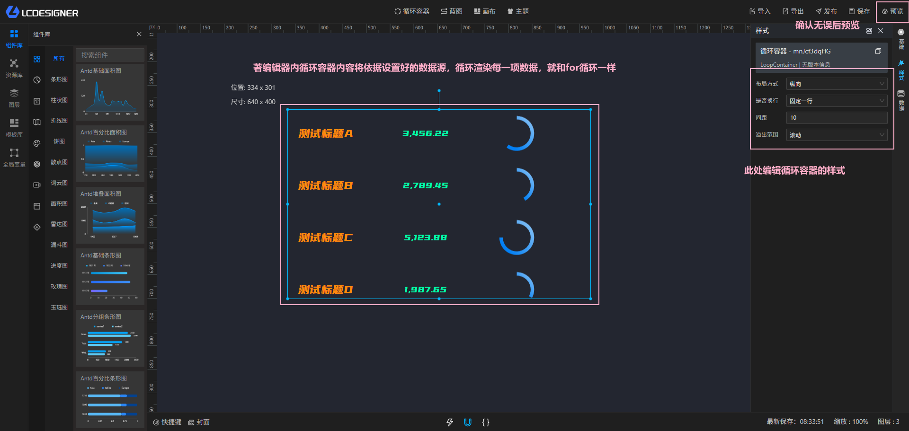
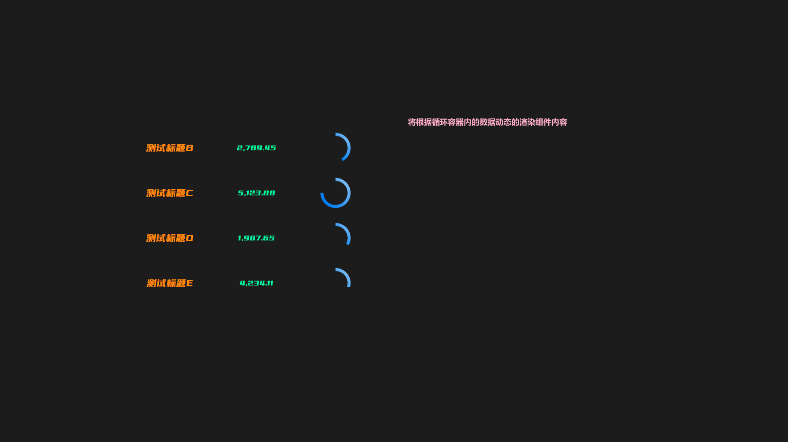

# 循环容器

循环容器用于把数组数据重复渲染成多个内容块，适合列表、卡片墙和类似“按数据批量展示”的场景。

## 它能做什么

- 按数组数据重复生成子组件
- 让每一项使用独立数据
- 让循环容器内部组件继续响应点击和显隐等操作

## 使用要求

!> 外部循环容器的数据源类型没有限制，可以是 API、数据库、MQTT 等所有已支持的数据源，但返回结果必须是数组。

## 使用流程

1. 在主设计器中添加循环容器
2. 为容器设置数据源
3. 配置循环容器内部的子组件样式
4. 保存后在预览中查看效果

