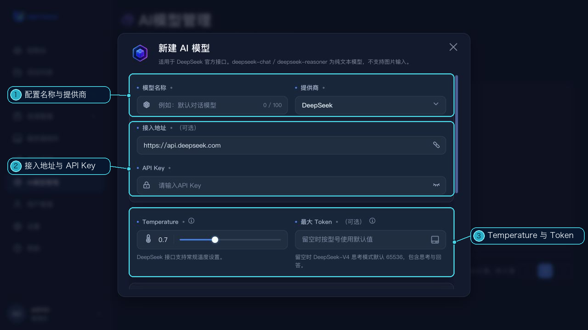

# AI 模型管理

AI 模型管理用于保存当前账号的 AI 服务接入配置。进入方式：左侧点击“AI 模型管理”。

## 当前提供商

新建和编辑表单提供 OpenAI、Qwen、Kimi、智谱 GLM、MiniMax、豆包（火山方舟）、腾讯混元、Google Gemini、xAI Grok、DeepSeek、小米 MiMo 和 Anthropic。

## 配置字段

- **模型名称**：在配置列表中识别这条连接的名称。
- **提供商、接入地址和 API Key**：按所选提供商填写。部分提供商会使用预设地址；API Key 不会以明文回显，编辑时留空表示保留已保存的 Key。
- **Temperature 和最大 Token**：Temperature 是否显示及其范围取决于提供商；最大 Token 数可选，留空时按所选型号使用默认值。
- **描述、启用状态和默认模型**：记录用途并控制配置是否可用。设为默认模型时会自动启用该配置。

“模型名称”用于在配置列表中识别这条配置。此管理表单不提供单独填写 API 型号标识的输入项。

## 管理操作

可新建、编辑、复制或删除配置，并按名称、提供商或接入地址搜索和分页浏览。复制会生成未保存的新配置，不会复制 API Key，也不会自动设为默认模型。

启用的配置可供产品 AI 功能选择；若需要自动使用默认配置，可将一条配置设为默认模型。不同提供商支持的参数及认证方式可能不同，请以表单随提供商变化显示的字段和提示为准。
