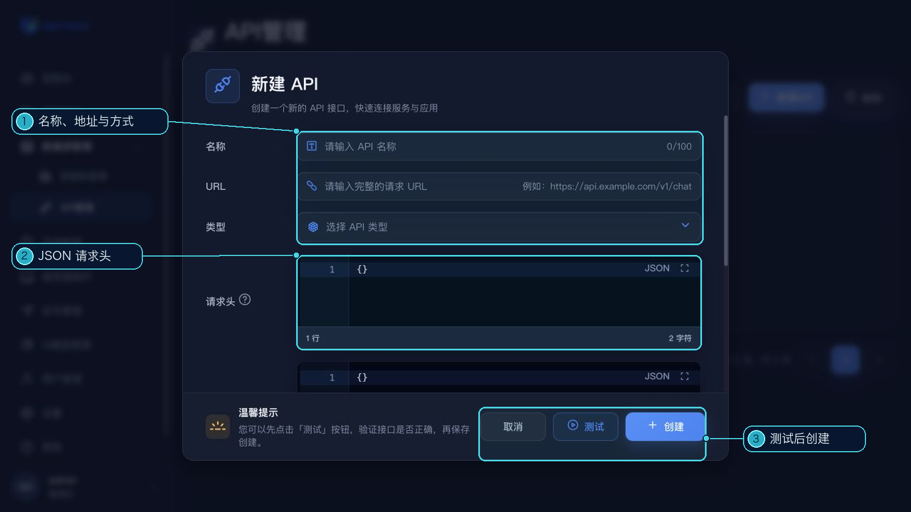

# API 管理

API 管理用于保存项目可以复用的公共 HTTP API 配置。进入方式：左侧“数据源管理”→“API 管理”。

## 配置内容

- 名称和请求地址
- 请求方式：`GET` 或 `POST`
- 请求头和请求参数：在编辑器中填写 JSON

## 创建和测试

1. 点击“新建 API”。
2. 填写名称、URL 和请求方式。
3. 按需要填写请求头和请求参数。
4. 点击“测试”，查看本次请求的响应结果。
5. 确认配置后保存。

列表支持搜索、分页、编辑、复制和删除；卡片上的复制图标可复制 URL。保存后可在支持公共 API 的项目数据配置中选择该 API。
