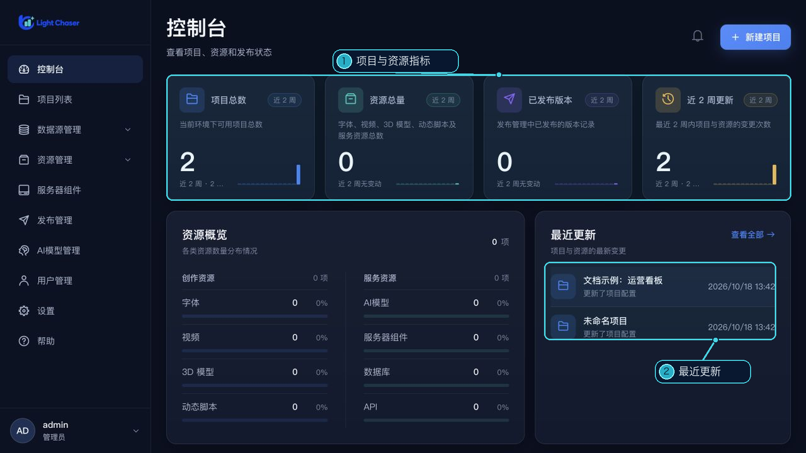

# 控制台

控制台把当前账号的项目、资源和发布记录集中呈现，适合进入系统后快速了解整体情况。数据加载不完整时，页面会提示部分数据失败，并提供重新加载入口。

## 页面内容

- **项目总数**：当前可访问的项目数量。
- **资源总量**：字体、视频、3D 模型、动态脚本、AI 模型、服务器组件、数据库和 API 的合计数量。
- **已发布版本**：发布管理中的发布记录数。
- **近 2 周更新**：项目、资源和发布记录中，近 14 天有更新时间的记录数。
- **资源概览**：按创作资源和服务资源分组显示数量及占比；点击某一项可进入对应管理页。
- **最近更新**：按时间显示最近 5 条项目、资源或发布记录。点击记录可进入对应管理页。
- **最近发布**：显示最近 5 条发布记录的名称、说明、更新时间、有效期和状态。

右上角的“新建项目”可以直接打开项目创建表单。通知图标当前不可用。

> “最近更新”只显示最近 5 条记录；如需查看完整项目、资源或发布内容，请进入对应管理页。
