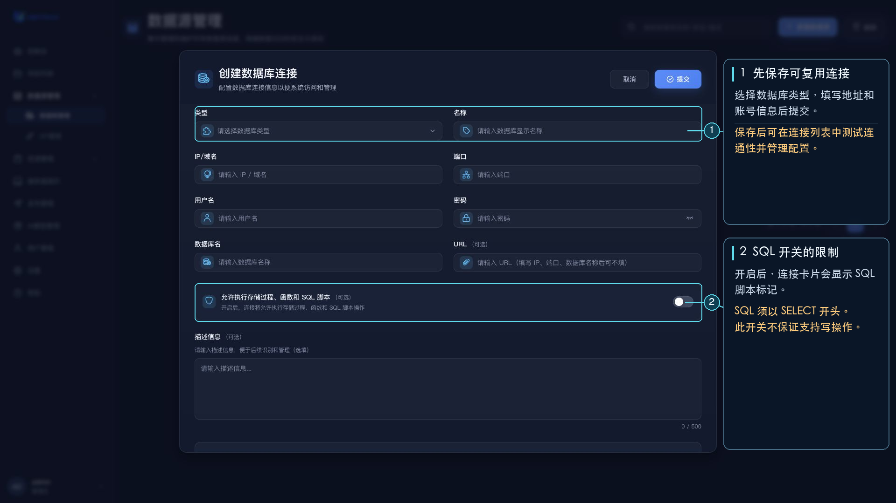

# 数据库管理

数据库管理用于创建可在项目中复用的数据库连接。进入方式：左侧“数据源管理”→“数据库管理”。

## 支持的数据库

- MySQL
- PostgresSQL
- Oracle
- SQLServer

## 创建连接

点击“新建数据源”，填写数据库类型、显示名称、IP 或域名、端口、用户名、密码和数据库名。URL、描述信息及“允许执行存储过程、函数和 SQL 脚本”开关为可选项。保存后，数据源会显示为列表卡片。

在卡片上可编辑、复制、测试或删除连接。连接测试针对已保存的数据源执行；列表支持按名称搜索及分页。

## SQL 执行限制

在项目中通过数据库连接运行 SQL 时，目前只接受以 `SELECT` 开头的语句。表单虽提供“允许执行存储过程、函数和 SQL 脚本”开关，但不能据此认为写入语句或其他非查询语句可以执行；运行查询时请使用以 `SELECT` 开头的语句。
