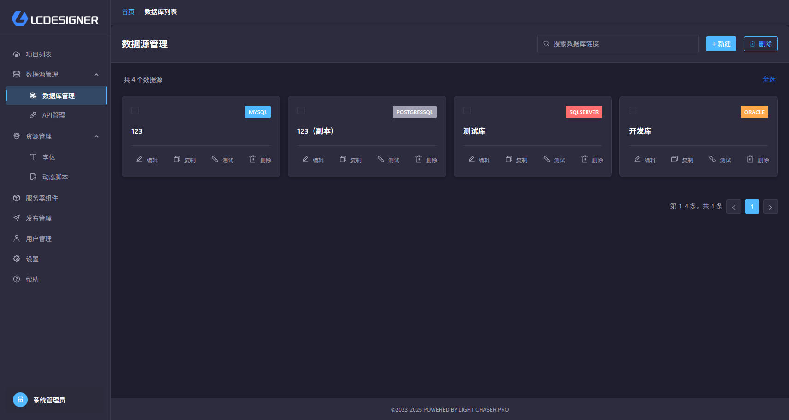
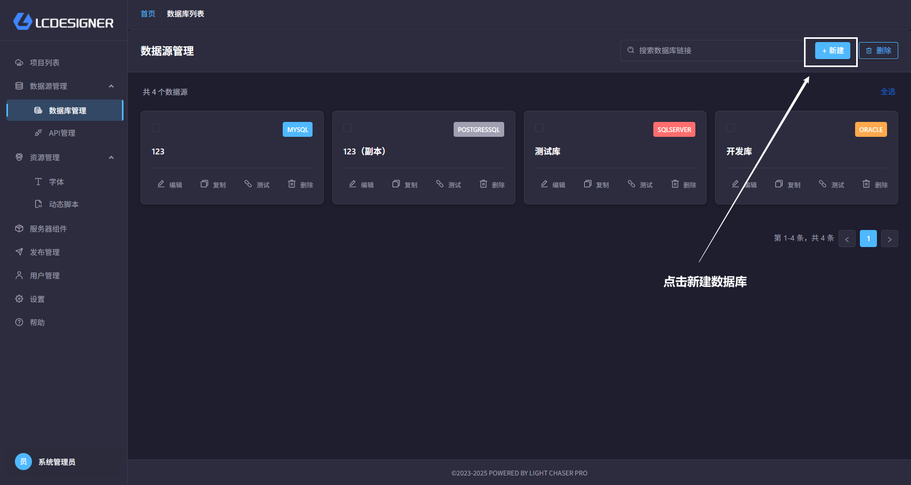
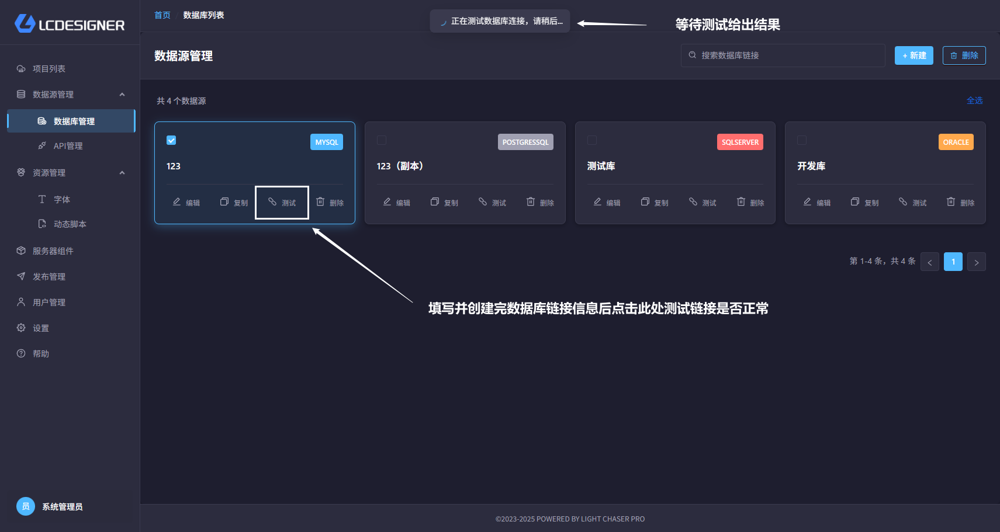
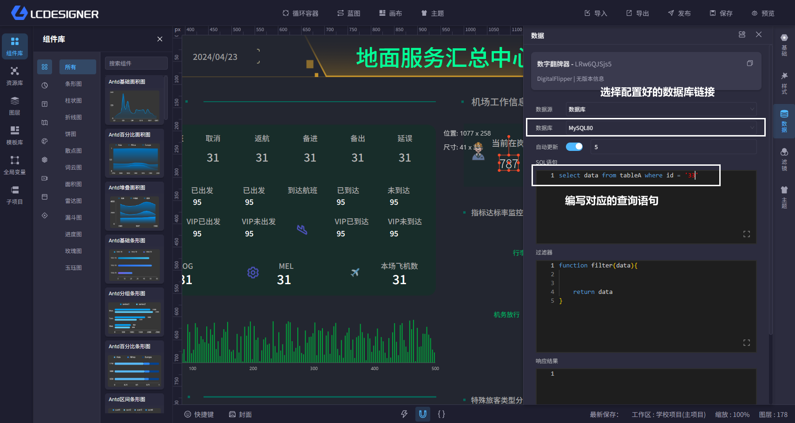
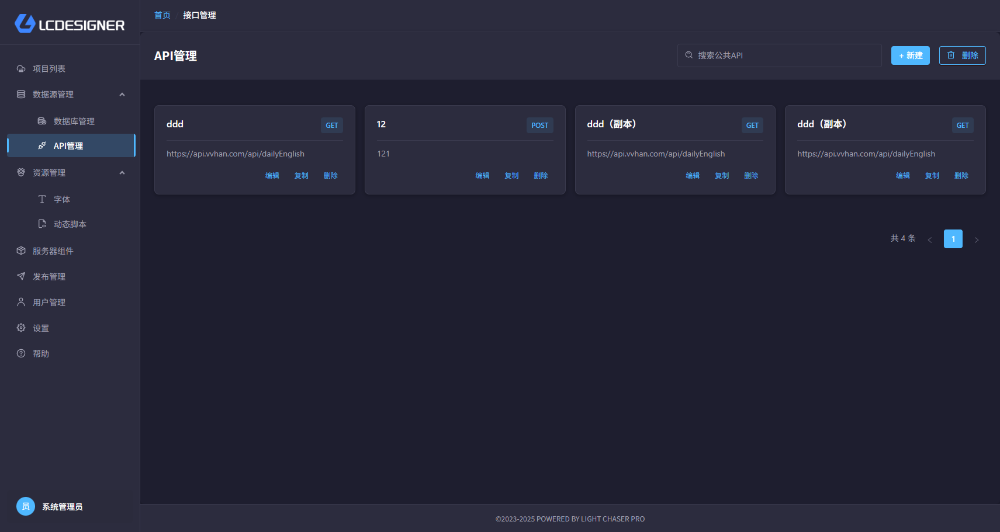
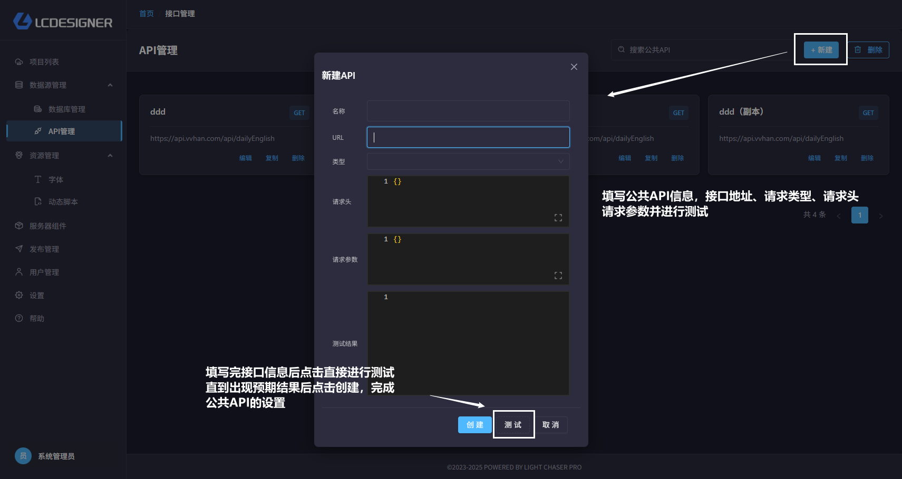
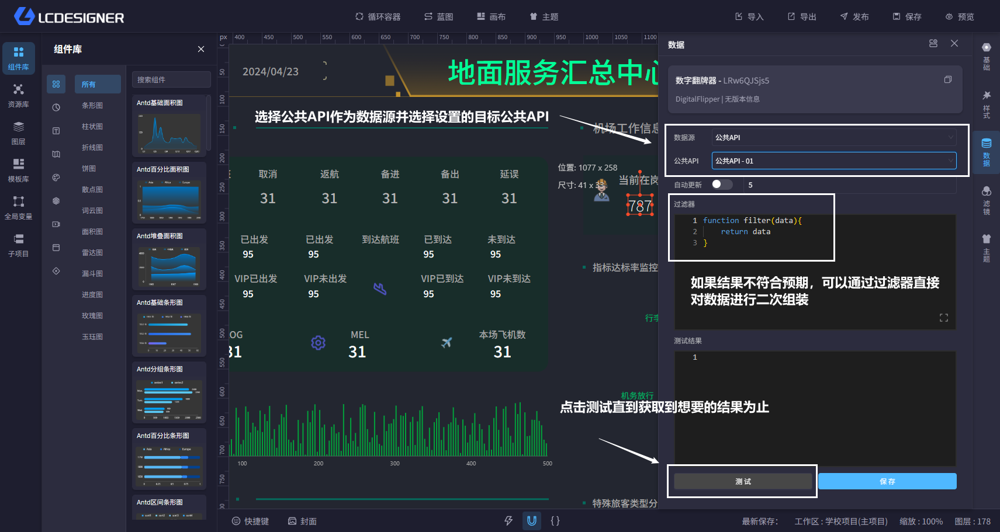

# 数据源管理

## 总览

数据源管理用于统一维护 LIGHT CHASER PRO 中可复用的数据源。配置一次后，可以在多个项目里重复使用。

当前主要分为两类：

- [数据库管理](database.md)
- [API管理](api.md)

如果你只是想先了解整体能力，可以先看这一页。

## 数据库数据源

所有支持数据源的组件都可以使用数据库数据源。你需要先在这里建立数据库连接，再在项目中引用。

目前支持的数据库类型如下：

- MySQL
- PostgreSQL
- SQL Server
- Oracle

#### 新建数据库链接

#### 测试数据库连接

#### 使用数据库数据源

!> 注：数据库作为数据源仅支持以`select`开头的SQL语句，任何非`select`语句或者试图直接修改数据库数据的操作都是被禁止的

## API数据源

#### 创建公共API

#### 使用公共API

