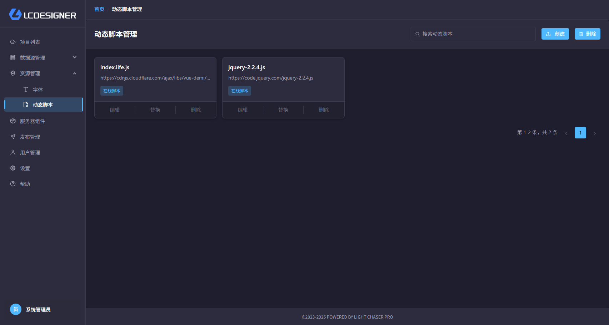
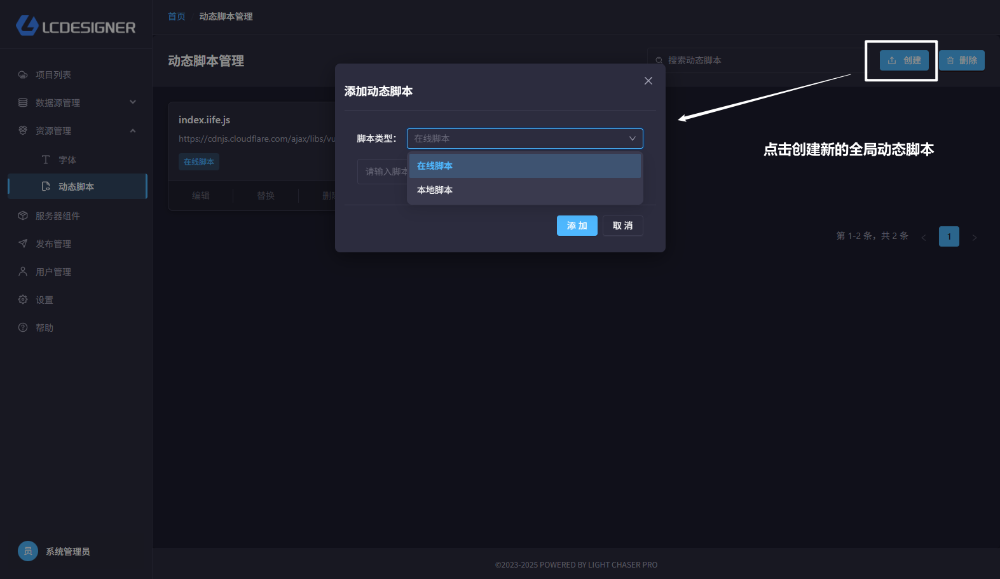
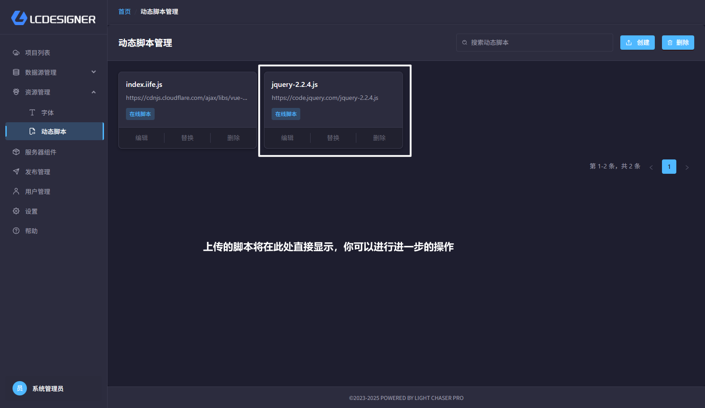
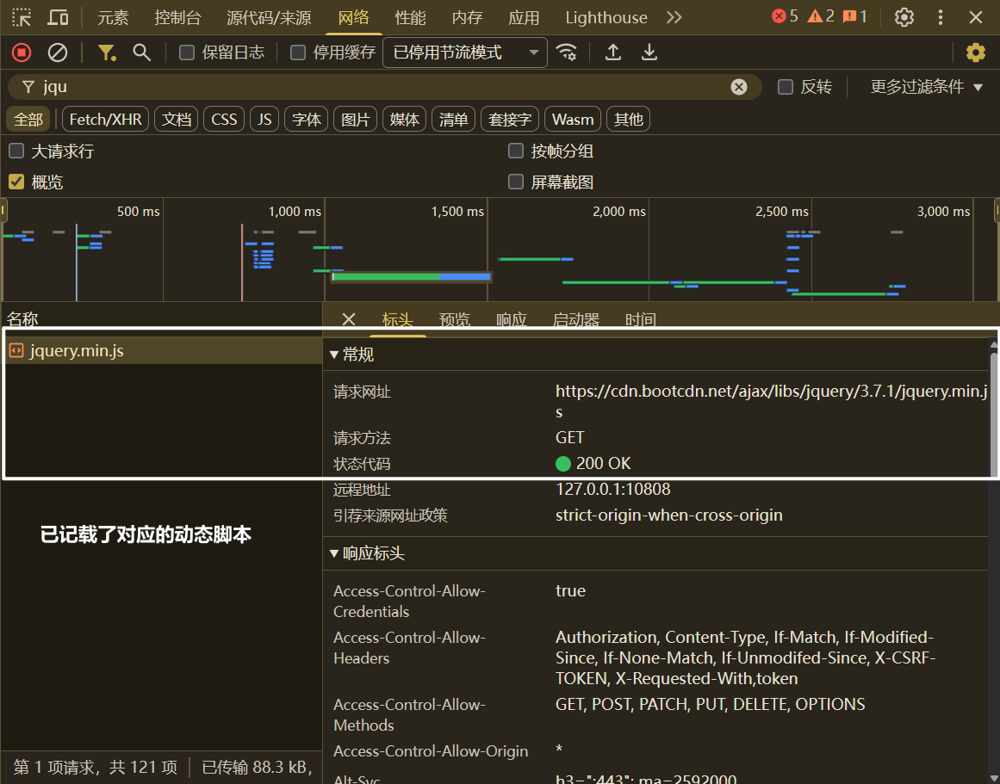
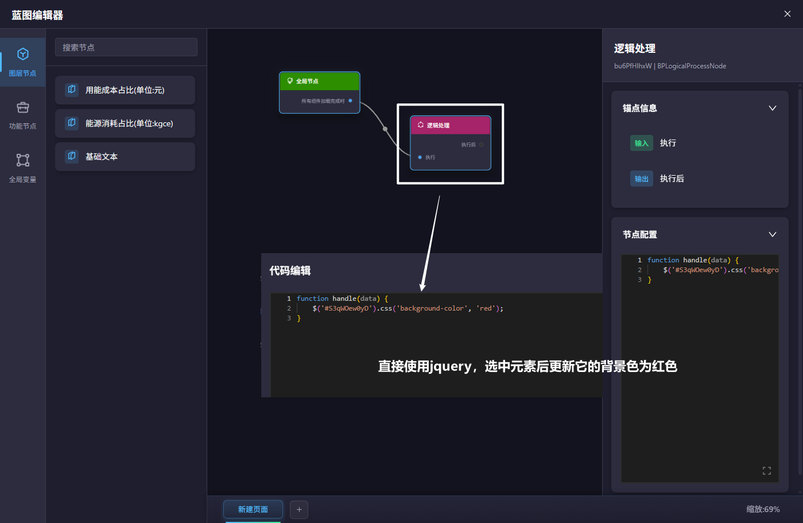

# 全局动态脚本

## 总览

全局动态脚本是所有项目都能共享的脚本资源。常见用法是把第三方工具库、效果库或公共函数统一放到这里，后面在任何项目里都能直接使用。

如果你只想让脚本在当前项目里生效，可以到 [项目设置](project_setting.md) 中管理项目级动态脚本。

?> 全局动态脚本的生效范围是所有项目。

## 可以创建什么

- 在线脚本：填写脚本地址或 CDN 地址，适合引入外部库
- 本地脚本：上传本地开发好的 `js` 文件，适合放公共工具代码

## 创建步骤

1. 进入 [资源管理](resource_management.md)
2. 点击 `动态脚本`
3. 点击 `创建`
4. 选择脚本类型
5. 填写名称并补充脚本地址或上传文件
6. 保存后回到编辑器使用

## 使用方式

- 在编辑、预览或发布页面刷新后，动态脚本会被重新加载
- 加载完成后，可以在主设计器或蓝图里直接引用第三方库
- 如果只是单个项目要用，优先放到 [项目设置](project_setting.md) 里

## 使用示例

