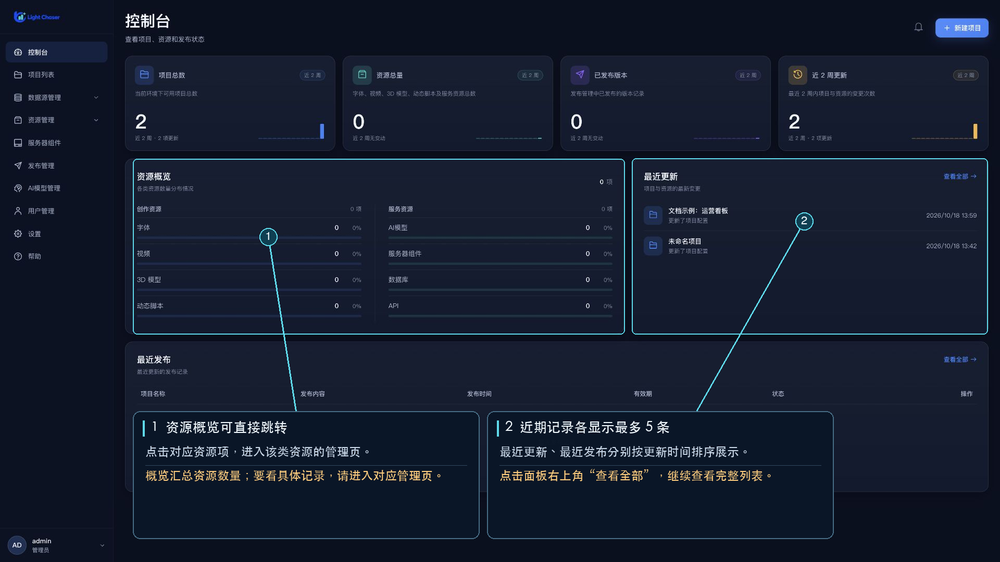

# 首页管理中心

登录后，LIGHT CHASER PRO 会进入 Web 管理中心。默认打开控制台；左侧侧栏用于切换项目、数据源、资源、组件、发布、AI 模型和帮助页面。

## 侧栏入口

- [控制台](/functions/home/console.md)：查看项目、资源、发布概况和近期变更。
- [项目列表](/functions/home/project_list.md)：新建、编辑、预览和管理项目。
- [数据源管理](/functions/home/datasource_management.md)：进入数据库管理或 API 管理。
- [资源管理](/functions/home/resource_management.md)：进入字体、动态脚本、视频或 3D 模型管理。
- [服务器组件](/functions/home/server_component.md)：上传、替换和维护设计器组件。
- [发布管理](/functions/home/release_management.md)：查看、更新和启停已发布内容。
- [AI 模型管理](/functions/home/ai_model_management.md)：维护 AI 功能可用的模型配置。
- [帮助](/functions/home/more_info.md)：打开教程、文档、官网和支持入口。
- [设置](/functions/home/setting.md)与[用户管理](/functions/home/user_management.md)：仅系统管理员在侧栏中看到这两个入口。

项目卡片右上角的操作菜单可打开该项目的[项目设置](/functions/home/project_setting.md)，目前此页用于管理项目级动态脚本。

## 账号菜单

侧栏底部显示当前账号头像、名称和角色。打开账号菜单可以进入[账号设置](/functions/home/setting.md)或退出登录。账号设置入口对登录用户开放；侧栏里的系统设置入口仅系统管理员显示。

## 建议

- 首次进入可先查看[控制台](/functions/home/console.md)，了解当前账号的项目和资源情况。
- 创建项目后，可从项目卡片的“设置”入口添加仅对该项目生效的动态脚本。
- 需要多个项目共用的字体、视频、模型或动态脚本，可从资源管理入口维护。
