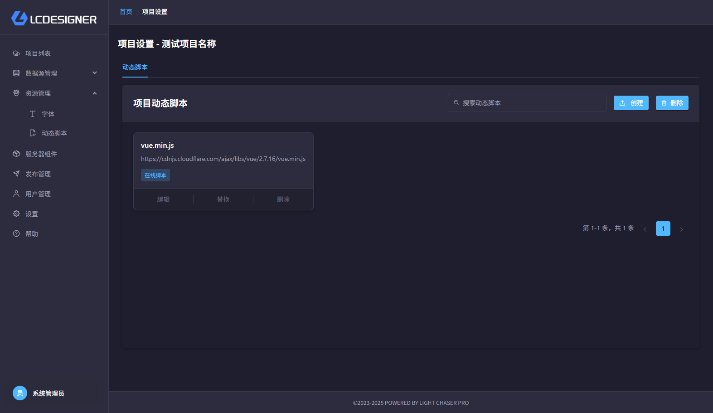
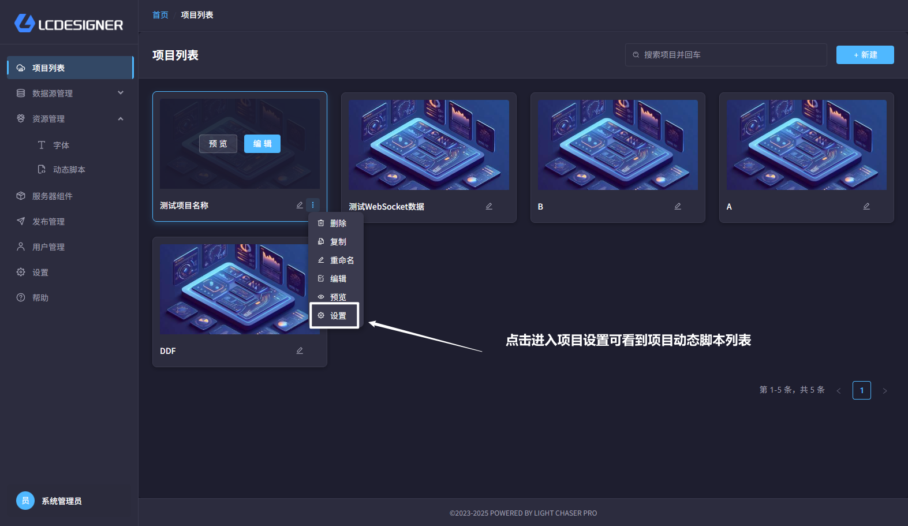

# 项目级动态脚本

## 总览

项目级动态脚本只对当前项目生效，适合给某一个项目单独加脚本逻辑，而不影响其他项目。

## 怎么进入

1. 打开 [项目列表](project_list.md)
2. 在目标项目上点击 `设置`
3. 进入 [项目设置](project_setting.md)
4. 切到 `动态脚本` 页签

## 适合做什么

- 给某个项目单独引入工具库
- 给某个项目补充专用效果代码
- 给某个项目放一段临时脚本，避免影响其他项目

## 使用建议

- 如果脚本需要所有项目共用，请去 [资源管理](resource_management.md) 中的 [全局动态脚本](global_dynamic_script.md)
- 如果只是当前项目要用，就保持在这里管理
