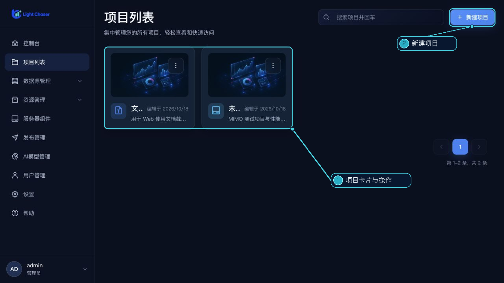

# 项目列表

项目列表以卡片展示当前账号可访问的项目。每页最多显示 6 个项目，可按关键词搜索；搜索时按回车提交。

## 新建项目

点击“新建项目”，填写项目名称、可选描述和画布宽高，再创建项目。默认画布为 1920 × 1080 px；名称最多 50 个字符，描述最多 200 个字符，宽和高的最小值为 300 px。

创建成功后会直接进入设计器。

## 项目卡片操作

打开卡片右上角菜单可执行以下操作：

- **编辑**：进入设计器；也可以双击卡片进入。
- **预览**：在浏览器新标签页打开项目预览。
- **复制**：创建当前项目的副本。
- **重命名**：在卡片上编辑名称并保存。
- **设置**：进入当前项目的[项目设置](/functions/home/project_setting.md)。
- **删除**：确认后删除项目。

列表底部提供分页。删除前请确认项目不再需要；删除后无法从项目列表恢复。
