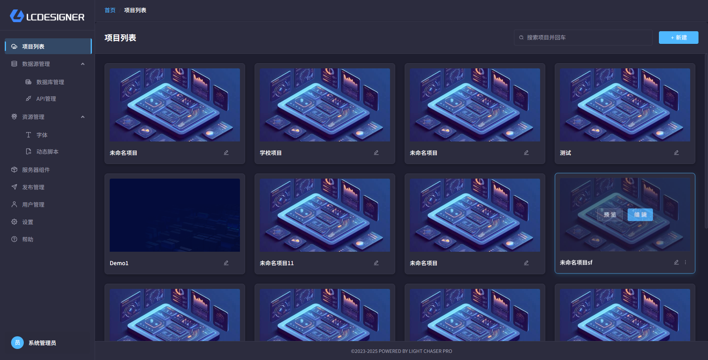
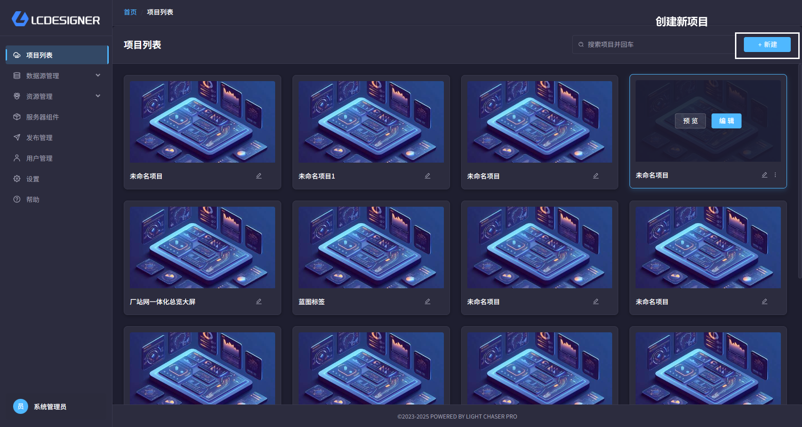
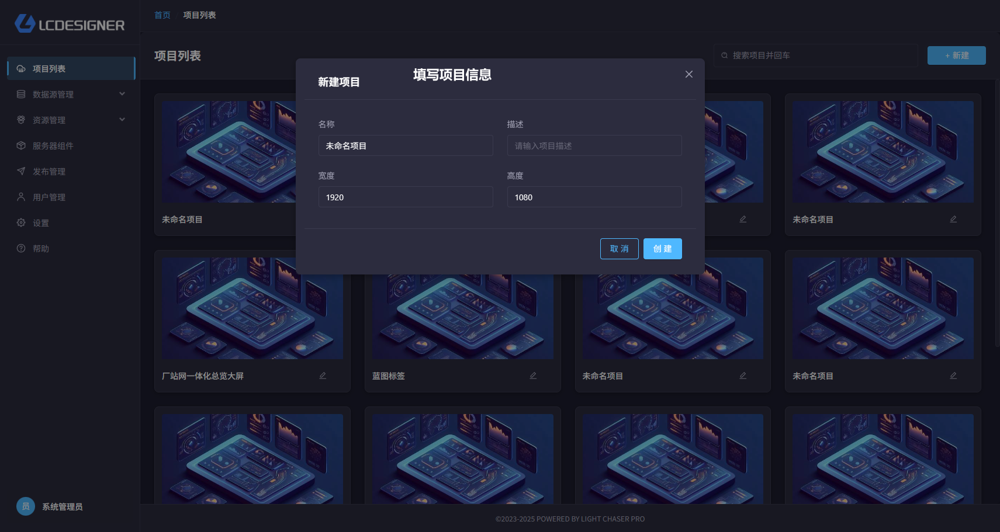
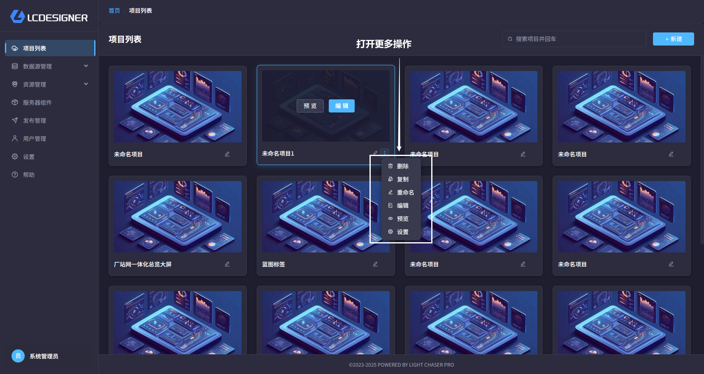

# 项目列表

## 总览

项目列表是你管理所有项目的地方。你在这里创建、打开、复制、重命名、预览和删除项目。

项目列表中的数据存储在服务端，需要后端服务配合才能正常使用。

## 你可以做什么

你可以通过项目列表进行以下操作：

- 新建项目
- 编辑项目
- 预览项目
- 复制项目
- 删除项目
- 搜索项目
- 分页浏览项目
- 进入项目设置

## 常用操作

- 点击“新建”可以创建一个项目，默认会让你填写名称、描述和画布尺寸
- 点击“编辑”进入主设计器
- 点击“预览”打开独立预览窗口
- 点击“复制”会生成一个新的项目副本，适合基于现有项目继续修改
- 点击“设置”可以进入当前项目的设置页

