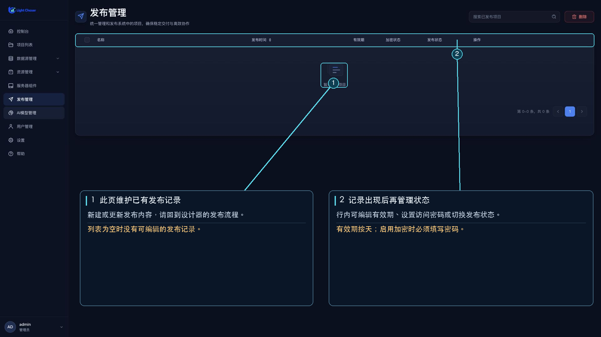

# 发布管理

发布管理用于维护已从设计器发布的项目。新建或更新发布内容请在设计器的“发布”流程中操作；此页面用于查看、编辑、启停和删除已有发布记录。

## 列表信息和操作

列表显示名称、项目说明、更新时间、有效期、加密状态和发布状态。可搜索、分页浏览、选择多条记录批量删除，或对单条记录执行以下操作：

- **编辑**：修改名称和有效期；可以开启加密并设置访问密码。
- **查看发布**：在浏览器新标签页打开发布页面。
- **发布状态开关**：在发布中和已停用之间切换。
- **删除**：删除发布记录；也可批量删除。

有效期以天为单位；未设置或为 0 时显示为“永久”。启用加密后必须设置密码。删除前请确认发布链接不再需要；删除后无法恢复。
