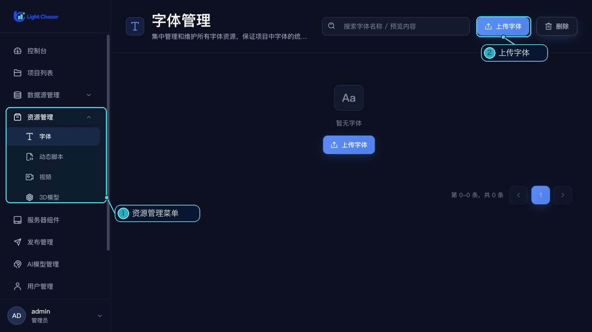

# 资源管理

左侧“资源管理”分组包含字体、动态脚本、视频和 3D 模型四个工作区。点击相应子菜单进入管理页；这里不包括数据库、API、AI 模型或服务器组件，它们在侧栏中有各自的入口。

| 资源 | 用途 | 说明 |
| --- | --- | --- |
| [字体](/functions/home/font.md) | 维护项目可用的字体文件 | 支持常见 Web 字体格式并提供预览 |
| [动态脚本](/functions/home/global_dynamic_script.md) | 管理所有项目可用的脚本资源 | 可保存远程脚本地址或上传本地 JavaScript 文件 |
| [视频](/functions/home/video_resource.md) | 管理可复用的视频素材 | 可预览资源并复制资源链接 |
| [3D 模型](/functions/home/model_resource.md) | 管理可复用的模型文件 | 支持常见模型格式及 ZIP 压缩包 |

需要只在一个项目中使用的脚本时，请从项目卡片的“设置”进入[项目级动态脚本](/functions/home/project_dynamic_script.md)。
