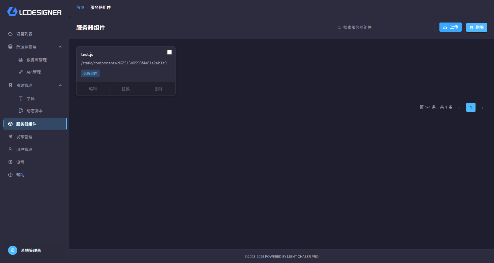
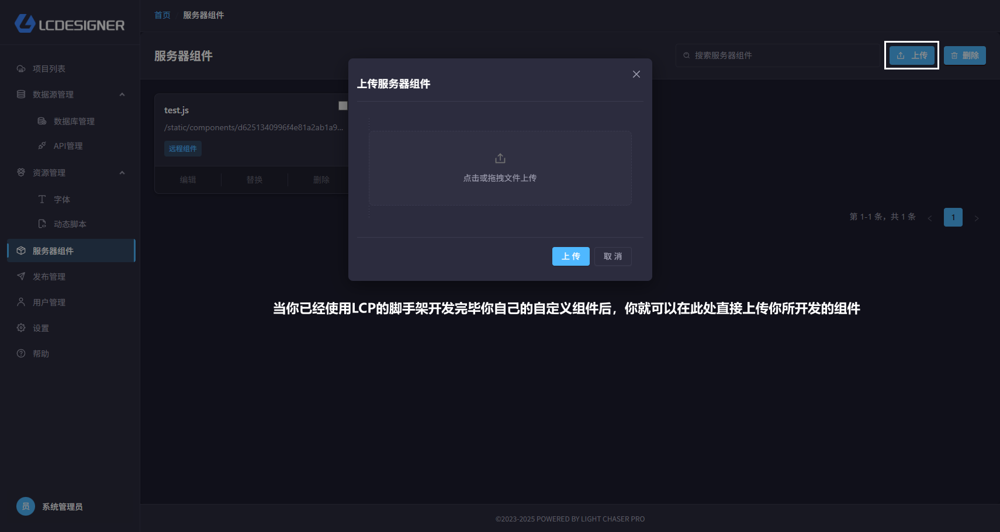
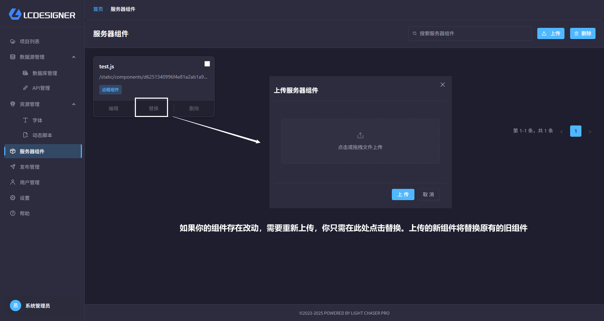
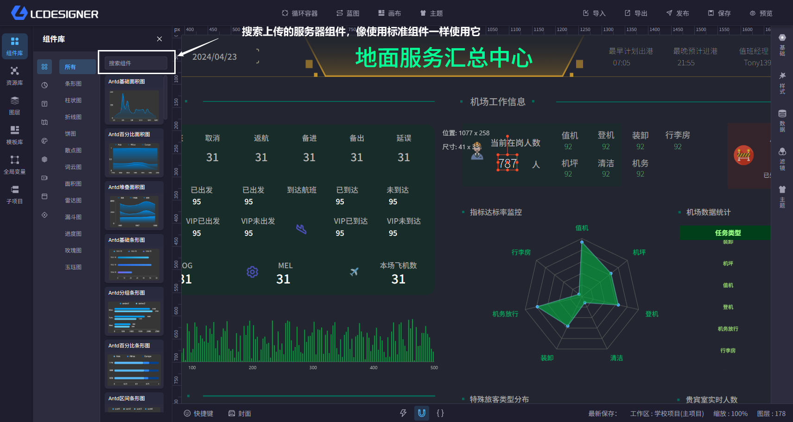

# 服务器组件

## 总览

服务器组件用于扩展主设计器里的可用组件。你可以把开发好的组件上传到这里，再在项目中直接使用。

## 常见流程

1. 使用开发脚手架完成组件开发
2. 打包生成产物
3. 在这里上传产物
4. 回到主设计器使用新组件

?> 如果你还没有开始开发组件，可以先看 [脚手架开发组件](/develop/develop_pro)

## 支持的文件

- `.js`
- `.mjs`

## 上传和替换

- 上传新文件会创建一个服务器组件条目
- 替换适合更新已有组件文件，原来的使用位置会保留

## 使用和删除

- 上传完成后，组件会出现在主设计器组件列表中，可像普通组件一样拖拽使用
- 删除前请先确认没有项目正在使用它，否则相关页面可能无法正常渲染

