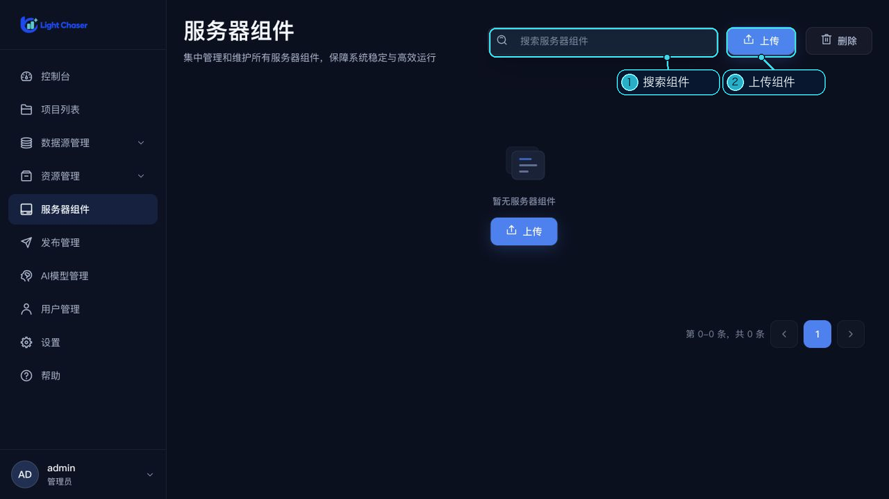

# 服务器组件

服务器组件用于把自定义组件加入主设计器的组件列表。进入方式：左侧点击“服务器组件”。

## 支持的文件

- `.js`
- `.mjs`
- `.zip`

上传前请先按[组件开发说明](/develop/develop_pro)完成组件开发和打包。

## 管理组件

- 点击“上传”并选择或拖入组件文件。
- 通过搜索框和分页查找组件。
- 可修改组件名称、替换组件文件，或删除单条/多条记录。
- 替换适用于更新已有组件；上传则新建组件记录。

组件上传后可在主设计器中使用。删除前请确认项目不再引用该组件，否则依赖它的页面可能无法正常渲染。
