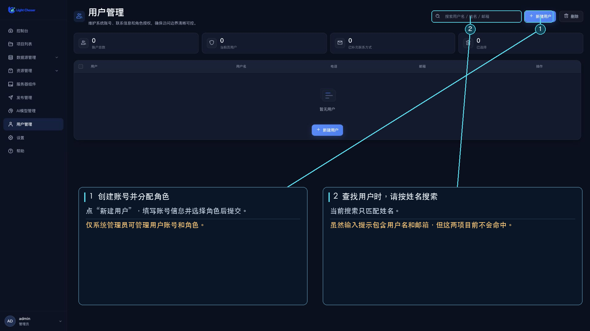

# 用户管理

用户管理用于维护普通系统账号及其角色。侧栏入口和用户列表、新建、批量删除接口仅对系统管理员（`SYSTEM_ADMIN`）开放；其他登录用户不能通过此页面管理账号。

## 可以执行的操作

- 搜索并分页查看用户。搜索框提示可搜用户名、姓名或邮箱，但当前搜索只按姓名匹配。
- 新建用户或编辑用户的姓名、用户名、电话、邮箱和角色。
- 选择一条或多条记录删除用户。

用户列表不包含系统管理员账号。创建表单没有密码输入项；新账号使用系统初始口令，请由管理员通过安全渠道告知。首次登录后，建议在[账号设置](/functions/home/setting.md)中修改。

## 新建或编辑用户

1. 点击“新建用户”，或在对应用户行点击“编辑”。
2. 填写用户名和姓名；电话、邮箱可按需填写。
3. 在“角色授权”区域选择一个或多个可用角色。
4. 点击“提交”保存。

删除操作会要求确认；删除后无法通过该页面恢复。请先确认账号和其访问权限不再需要。
