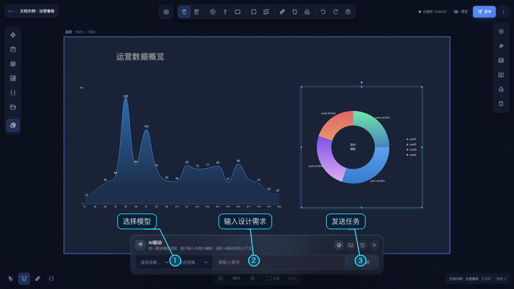
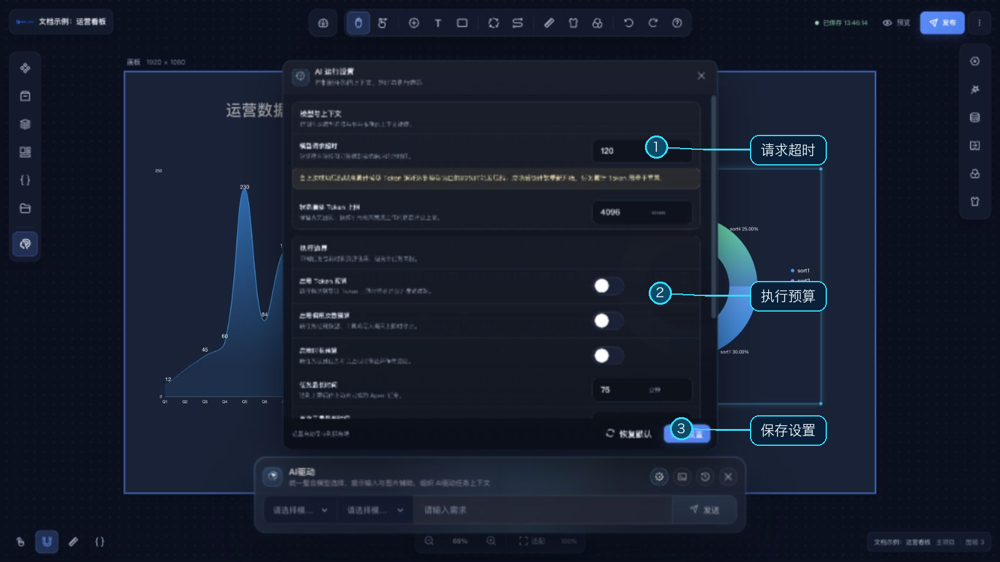

# AI 驱动

主设计器左侧栏底部的 **AI 驱动**按钮会打开 AI 任务面板。面板用于提交设计需求，并结合当前项目画布上下文执行任务；使用前需先在 [AI 模型管理](/functions/home/ai_model_management.md)中配置可用模型。

## 提交任务

1. 打开 AI 驱动面板，选择模型配置和模型型号。
2. 在输入框描述需求；需要视觉参考时可粘贴图片。输入 `/` 可查看面板支持的快捷指令。
3. 点击发送。任务运行时可查看步骤、过程信息和 Token 用量，也可以停止当前任务。
4. 如果任务要求确认画布预览，先检查临时结果，再选择确认或拒绝；确认后才会写入正式画布。

面板还提供历史记录，可查看以往任务或继续未完成的任务。运行设置中可以调整模型请求超时、上下文以及新任务的 Token、调用次数和时长限制；设置对后续新任务生效。

如果模型列表为空，请先检查 [AI 模型管理](/functions/home/ai_model_management.md)中的模型配置和可用状态。AI 修改画布前请检查预览结果，确认改动符合预期。
