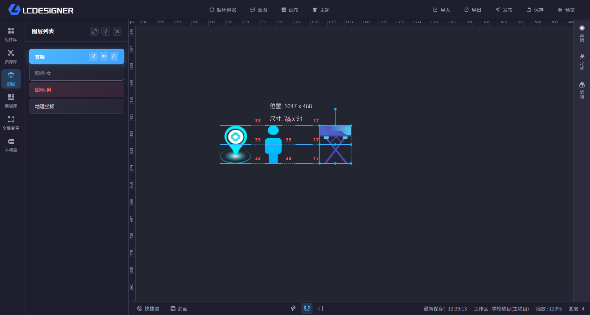

# 自动吸附

## 总览

主设计器底部的“吸附”按钮用于开启或关闭自动吸附。开启后，拖拽和缩放组件时会更容易贴近其他组件或画布边缘，方便快速对齐。

## 怎么用

- 点击底部的“吸附”按钮切换开关
- 开启后，组件拖拽和缩放会带有吸附效果
- 关闭后，组件按自由拖拽和缩放处理，适合做细微调整

## 使用建议

- 大多数排版场景建议保持开启
- 如果你要做非常精细的偏移微调，可以先关闭再调整
