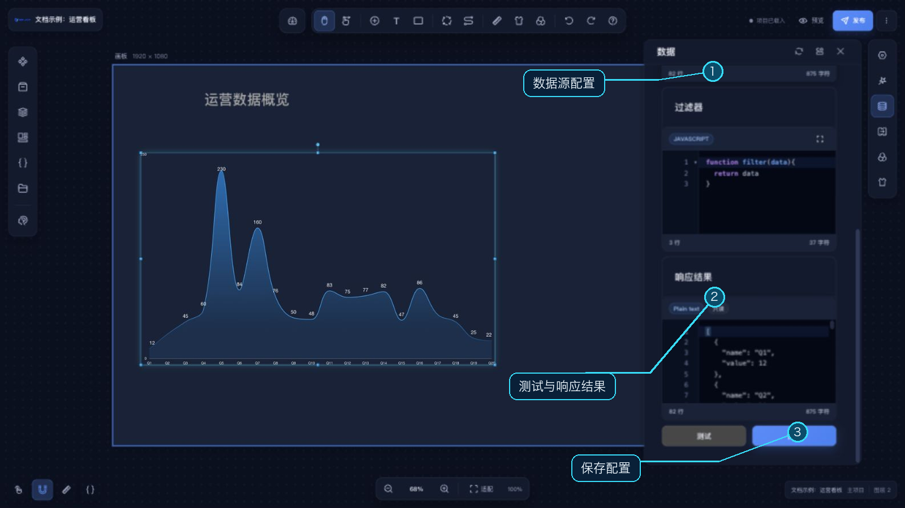

# 组件配置

在画布中双击组件可激活组件配置；右侧菜单会根据当前组件显示可用设置。双击分组会激活整个分组；按住 `Shift` 再双击组内目标组件，可打开该组件的配置。若要单独选中组内子组件，可按住主修饰键（Windows 为 `Ctrl`，macOS 为 `⌘`）进行深入选择。

## 常见配置

- **基础**：查看组件信息并调整位置、尺寸等基础属性。
- **样式**：不同组件提供不同的外观和内容配置。
- **主题**：选择主题预设并应用到当前组件，详情见[主题](/functions/main_desiner/theme.md)。
- **滤镜**：调整当前组件的模糊、亮度、对比度、透明度、饱和度和色调。
- **数据**：按组件能力配置静态数据、API、公共 API、数据库、全局变量、WebSocket 或 MQTT 数据源。循环容器编辑状态下，组件数据面板仅开放静态示例数据。
- **映射**：当组件提供数据映射功能时，将数据字段绑定到图表等组件的轴或字段。

不同组件显示的设置菜单可能不同；组件还可以提供额外的专属配置项。

## 配置辅助操作

配置面板可复制组件 ID、复制当前组件配置 JSON，并将配置恢复到组件默认值。组件支持多个状态时，还可从面板的状态管理入口新增、切换、重命名和删除状态；详情见[组件组态](/functions/main_desiner/component_multi_status.md)。

数据源中的全局变量引用方式见[全局变量](/functions/main_desiner/global_variable.md)。公共 API 和数据库的统一配置方式分别见[接口管理](/functions/home/api.md)和[数据库管理](/functions/home/database.md)。
