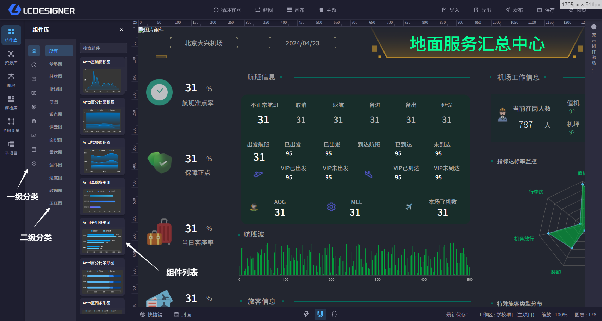

# 组件库

## 总览

组件库会展示设计器中的所有组件，包括系统内置组件和已经上传的服务器组件。

组件库包含两层分类结构：

- 一级分类：组件的大类型分类，例如图表、地图、表单控件
- 二级分类：组件的详细分类，例如折线图、柱状图、饼图

你可以通过分类和搜索快速找到目标组件。

## 怎么放到画布里

有两种方式把组件放到画布中：

- 双击组件卡片，组件会直接出现在画布左上角
- 按住鼠标左键拖拽组件到画布，松开后会放到鼠标所在位置

拖拽时会先出现一个跟随鼠标的浮层，方便你确认当前拖的是哪个组件。

## 放置后可以做什么

- 调整组件大小和位置
- 打开右侧配置区修改样式和数据
- 参考 [快捷键](hotkey.md) 快速移动、复制或删除组件
- 参考 [组件配置](component_config.md) 修改当前组件效果
- 参考 [画布](canvas.md) 调整整个项目的显示方式
