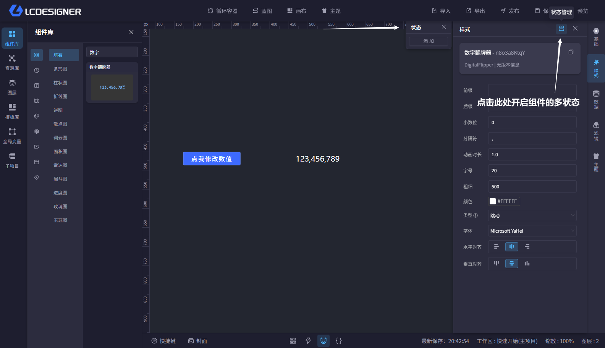
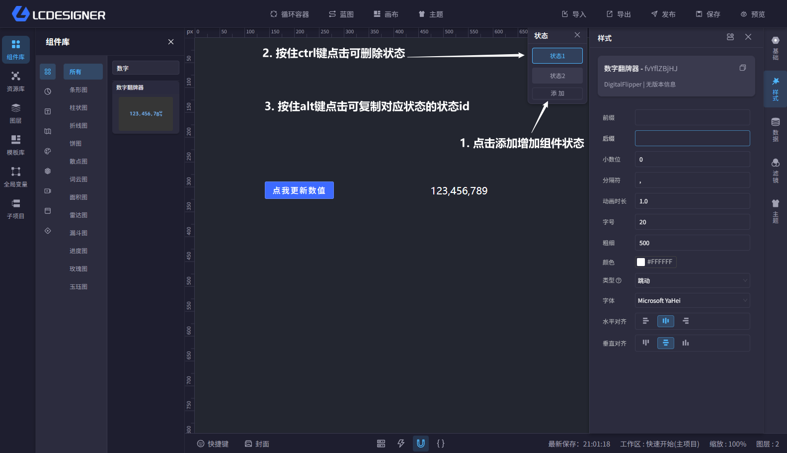
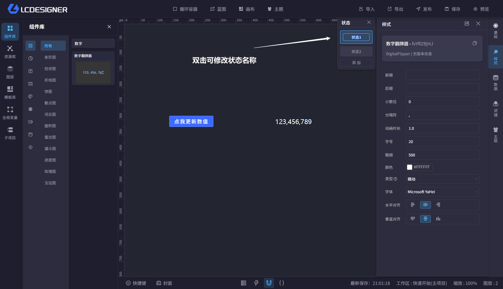
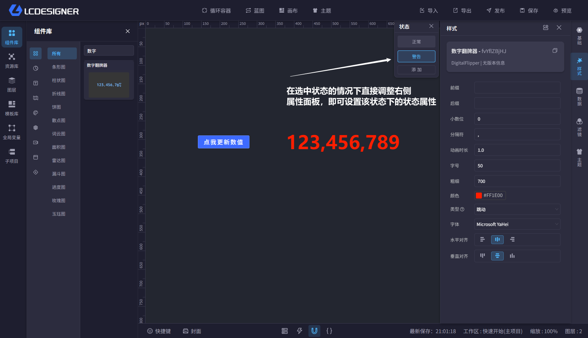
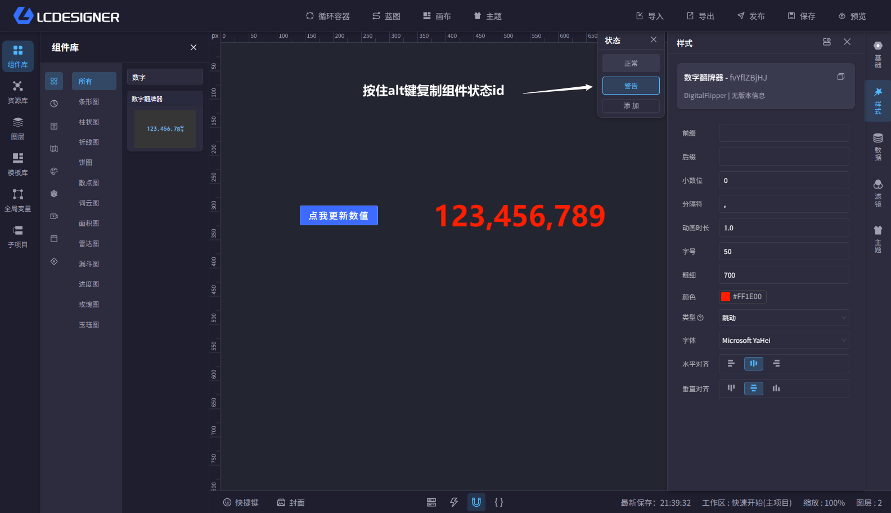
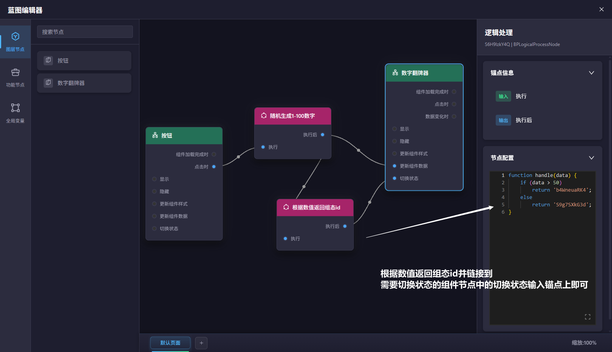

# 组件组态

组件组态就是让同一个组件拥有多个状态。比如默认、悬停、选中、展开等，每个状态都可以有不同的内容和样式，适合做按钮、卡片、开关和展开面板这类效果。

## 开启组态

?> 每个组件默认只有一个状态（即你当前看到的状态）

## 操作组件状态

- 你可以新增状态
- 也可以复制现有状态后再修改
- 切换状态后会看到对应状态的内容

## 修改状态名称

## 设置状态内容

## 切换状态

切换组件状态需要借助蓝图系统。通常会先复制状态 id，再在蓝图节点里使用这个 id 去切换状态。

