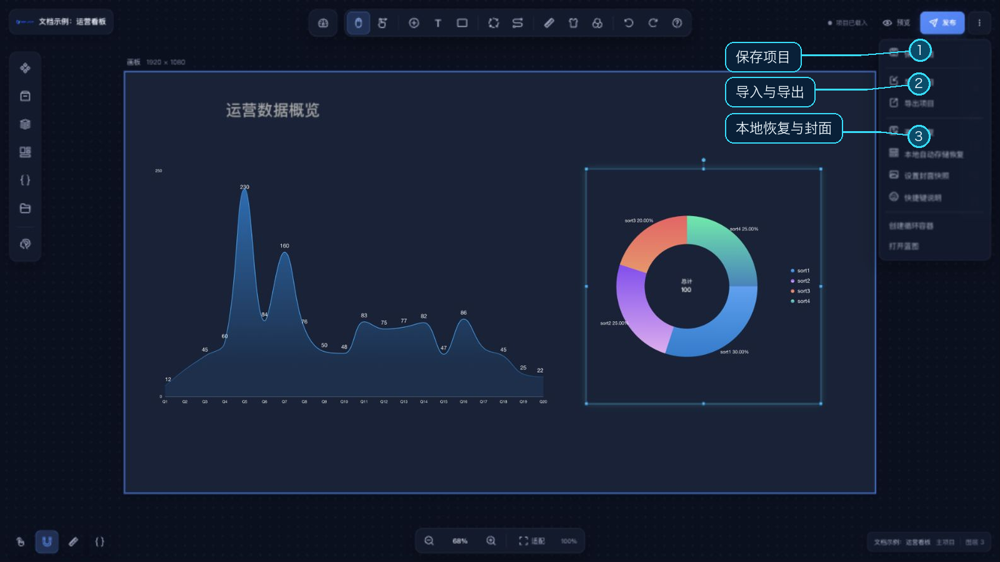

# 导入与导出项目

导入/导出入口位于主设计器顶部的“更多项目操作”菜单。导出会生成 ZIP 项目包，浏览器下载到本机；导入会把 ZIP 中的项目数据写入当前项目，完成后重新载入编辑器。

## 导出

1. 打开“更多项目操作”菜单并选择“导出项目”。
2. 在导出选项中选择是否加密整个项目包。启用加密时，输入并确认导出口令。
3. 检查导出风险提示；确认后等待服务器生成项目包。
4. 浏览器下载以当前项目名称命名的 `.zip` 文件。

导出会沿项目引用关系收集入口项目及其依赖项目。若依赖图存在循环引用，导出会提示错误并停止。包含公共 API 或数据库的数据包必须启用整包加密；相关配置还可能触发凭据风险提示。导入加密包时需要同一导出口令，请妥善保管。

## 导入

1. 打开“更多项目操作”菜单并选择“导入项目”，再选择 `.zip` 文件。
2. 若压缩包或其中的加密数据源需要口令，在导入窗口填写口令；明文包可留空。
3. 点击“开始导入”并等待处理完成。成功后页面会重新载入。

## 导入后检查

打开项目并检查画布、组件引用和数据连接。公共 API、数据库等外部服务是否可用，取决于目标环境中的对应配置；外部图片、视频、字体和模型资源也应在预览中逐项确认。

