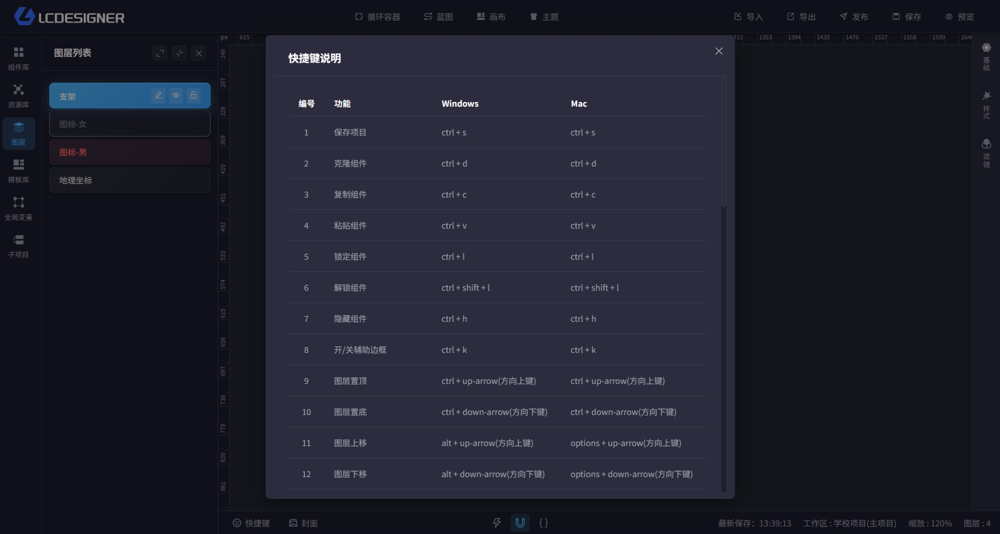

# 快捷键

## 总览

主设计器左下角可以打开快捷键说明，查看当前支持的所有快捷操作。

当前共支持 41 项快捷操作，覆盖保存、复制、粘贴、锁定、隐藏、图层排序、编组、对齐、画布操作和面板切换。

## 常用快捷键

- `Ctrl + S`：保存项目
- `Ctrl + D`：克隆组件
- `Ctrl + C` / `Ctrl + V`：复制、粘贴组件
- `Ctrl + L` / `Ctrl + Shift + L`：锁定、解锁组件
- `Ctrl + H`：隐藏组件
- `Ctrl + K`：开关辅助边框
- `Ctrl + ↑` / `Ctrl + ↓`：图层置顶、置底
- `Alt + ↑` / `Alt + ↓`：图层上移、下移
- `Delete`：删除组件
- `Ctrl + Z` / `Ctrl + Shift + Z`：撤销、重做
- `Ctrl + 1` / `Ctrl + 2` / `Ctrl + 3` / `Ctrl + 4`：打开或关闭项目设置、画布设置、主题和快捷键说明

## 使用说明

- Windows 和 Mac 的大部分快捷键一致
- Mac 上删除组件时会使用 `Command + Backspace`
- 不同快捷键会在图层区、画布区或蓝图区生效，具体以弹窗列表为准
