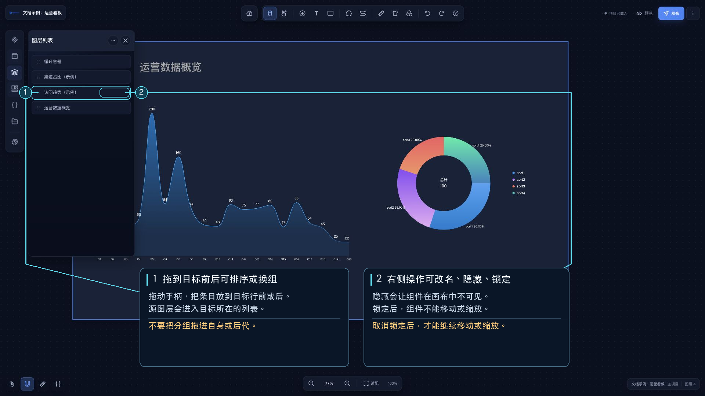

# 图层

图层面板显示当前画布中的组件和分组。点击图层条或画布组件可选择对象；图层面板顶部菜单可展开或折叠所有分组。

## 管理图层

- 拖动图层条上的拖拽手柄可调整前后顺序；移到另一组成员的前后时，图层会继承目标成员所属的分组。
- 图层条提供重命名、隐藏和锁定操作；双击名称可编辑名称。
- 多选图层后，可通过右键菜单或快捷键进行编组、解除编组、从分组移除、对齐和图层排序。
- 隐藏会让组件从画布中不可见；锁定会阻止移动和缩放，便于避免误操作。

拖动排序可能同时改变分组归属，请检查目标位置。不能把图层拖到自身或自身后代的位置。全部快捷键见[快捷键](/functions/main_desiner/hotkey.md)。
