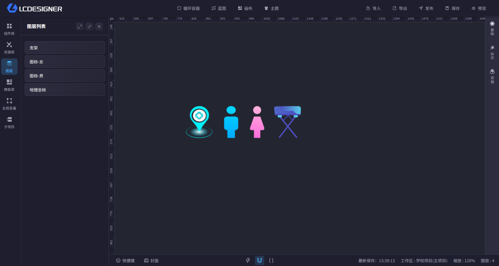
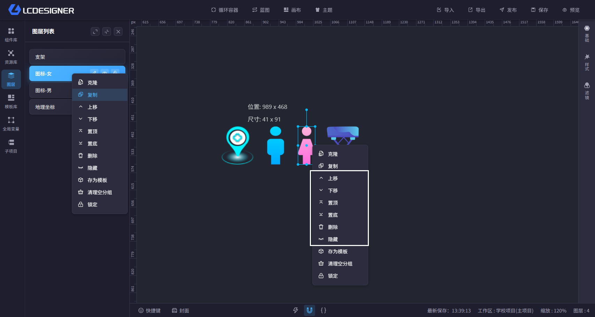
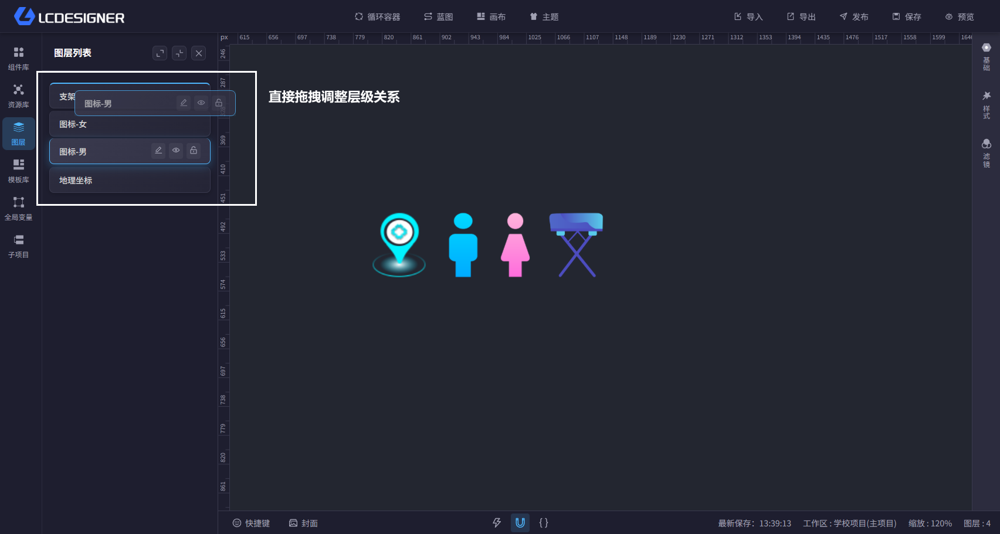
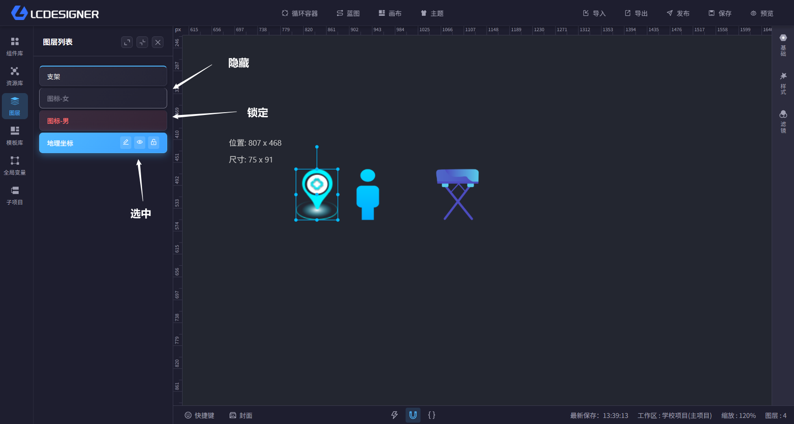

# 图层

图层用于描述画布上组件的层级关系。你可以把它理解为“画布里所有组件的列表视图”。

## 怎么管理图层

当你将组件拖入画布中时，组件会自动加入图层列表，并位于列表顶层。

当图层列表中出现多个图层时，你可以：

- 调整上下顺序
- 进行编组或解除编组
- 将已经组合的图层从组合中移除
- 将整个组合打散

你可以在图层列表中选中组件，也可以直接在画布中选中组件。之后再通过右键菜单或快捷键对图层进行操作。

下图展示的是图层条上的常用操作入口，例如重命名、隐藏、锁定等。

下图展示的是通过拖拽图层条调整前后层级关系的效果。

全部快捷键操作请参考 [快捷键](hotkey.md)。

> 注意：图层的上移、下移、置顶、置底操作均只能在本层级下生效。例如 A、B、C、D 四个图层处于同一个分组内时，置顶只会在这个分组内生效，不会把它移到整个画布最上层。

## 图层状态

图层有 3 种状态，不同状态下的表现如下：

1. 正常状态：组件可正常编辑，图层未选中时没有特殊颜色，选中后显示蓝色
2. 锁定状态：组件不能移动和缩放，但仍可以被选中，列表中通常显示为红色
3. 隐藏状态：组件从画布消失，无法在画布中直接选中，列表中通常显示为灰色

下图展示了正常、锁定和隐藏三种状态在列表中的区别。

锁定适合防止误操作，隐藏适合临时收起不需要显示的内容。
