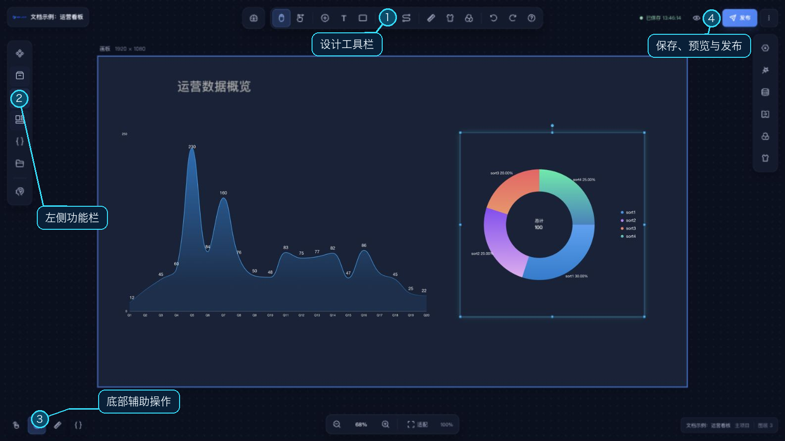

# 主设计器

主设计器是 Web 端的页面编辑工作区。画布位于中央，组件与项目工具分布在两侧工具栏；组件被激活后，右侧出现对应的配置菜单。顶部显示项目名称、保存状态，并提供预览、发布和更多项目操作。

## 工作区区域

- **左侧功能栏**：组件库、资源库、图层、模板库、全局变量和子项目；底部按钮打开 **AI 驱动**面板。
- **画布工具栏**：选择/抓手工具、打开组件库、快速添加文本或色块、创建循环容器、打开蓝图，以及画布、主题和全局滤镜设置；撤销、重做和快捷键帮助也在这里。
- **中央画布**：放置和编辑组件。选中组件后，右侧会显示组件配置入口；标尺、缩放和画布显示范围帮助定位。
- **右侧配置区**：双击组件后出现，配置项由组件类型决定。
- **底部状态与辅助操作**：显示当前项目、场景和图层数；可切换原生事件、吸附、标尺，并打开组件配置代码编辑器。

## 项目操作

顶部状态会显示“保存中”“已保存”和最近保存时间；保存失败时可点击状态重试。点击 **预览**会先保存项目，再打开预览页面；点击 **发布**配置访问链接。更多项目操作菜单中包含手动保存、导入/导出、画布修复、本地快照恢复、封面快照、快捷键说明，以及循环容器和蓝图入口。

项目设置可从工具栏打开；默认 `Ctrl/⌘ + 1` 切换项目设置，`Ctrl/⌘ + 2` 切换画布设置，`Ctrl/⌘ + 3` 切换主题设置，`Ctrl/⌘ + 4` 切换快捷键设置。快捷键可在设置面板中修改，实际绑定以当前面板显示为准。

各区域的操作方式见 [组件库](/functions/main_desiner/component_lib.md)、[画布](/functions/main_desiner/canvas.md)、[图层](/functions/main_desiner/layer.md)、[组件配置](/functions/main_desiner/component_config.md)、[保存](/functions/main_desiner/save.md)、[预览](/functions/main_desiner/view/preview.md)和[发布](/functions/main_desiner/publish/publish.md)。
