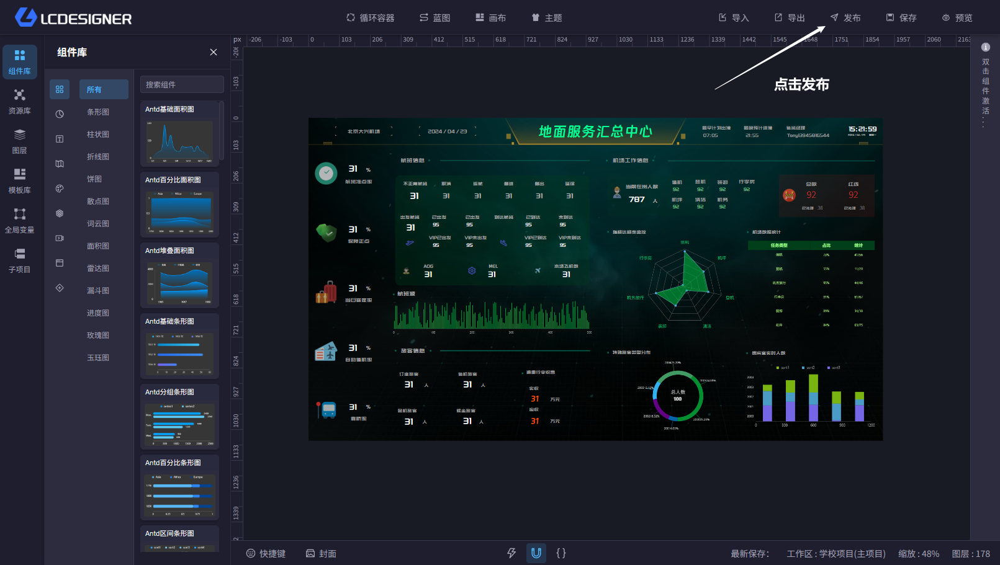
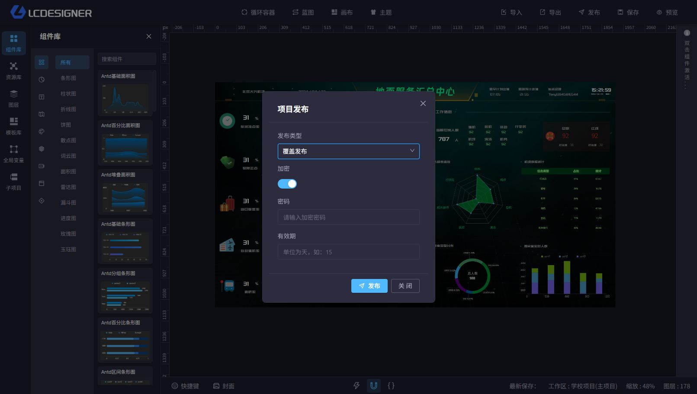

# 发布

## 总览

发布会把当前项目生成一个独立访问页面，适合直接分享给别人查看。

当项目设计完成后，你可以把项目发布成一个独立访问页面，方便直接分享或交付。

## 设置发布

下图是发布配置窗口。

### 发布步骤

1. 点击主设计器右上角的“发布”
2. 选择发布类型
3. 选择是否加密
4. 如果需要，填写访问密码和有效期
5. 点击“发布项目”
6. 发布成功后点击“查看发布”

#### 发布类型

点击“设置发布”后，会弹出发布配置窗口。项目发布有两种类型：

- 覆盖发布：如果当前没有发布，则创建一个发布；如果当前已经有发布，则更新当前发布，访问链接保持不变
- 增量发布：每次都会生成新的发布版本，并生成新的访问链接

#### 加密

创建发布时，可以设置是否加密。加密发布后，只有输入密码才能访问。

#### 有效期

创建发布时，可以设置发布有效期，单位为天。不设置时，默认为永久。

## 查看发布

发布完成后，可以从首页的 [发布管理](../../home/release_management.md) 中打开查看，也可以直接访问发布链接。

- 桌面端会在独立窗口中打开
- 浏览器端会在新标签页中打开

> 如果开启了加密发布，查看时需要先输入密码。

> 发布效果与当前项目配置有关，建议在最终交付前先完整预览一次。
