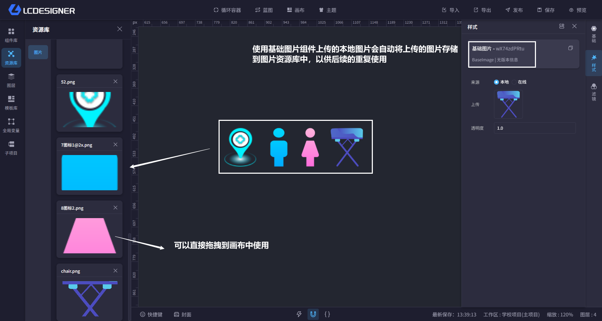

# 资源库

资源库位于左侧菜单栏的组件库下方，用来存放已上传、可复用的素材资源。

首页里的资源管理上传完成后，常用素材会在这里以可拖拽资源的形式展示出来。

当前资源库分为两个分类：

- 图片
- 视频

## 怎么使用

1. 先在首页的资源管理里上传图片或视频
2. 回到主设计器，在资源库中找到对应资源
3. 按住左键拖到画布中
4. 松开后，系统会自动放入对应的图片组件或视频组件
5. 不再需要时，可以回到首页资源管理删除资源

重复上传相同资源时，系统会优先复用已存在的资源，减少重复存储。

> 删除资源前请先确认是否已经被当前项目使用，避免画布中的组件失效。

