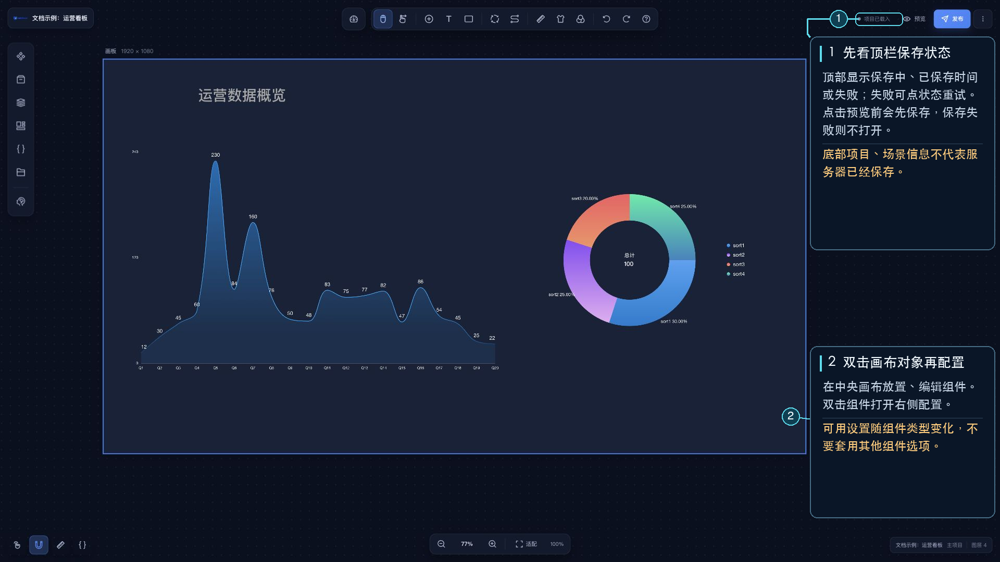

# 保存与本地快照

## 保存项目

项目数据保存到服务器。可使用 `Ctrl + S`（macOS 默认 `⌘ + S`），也可在主设计器顶部的“更多项目操作”菜单中选择“保存项目”。顶部保存状态会显示保存中、已保存和最近保存时间；如果保存失败，点击状态可以重试。预览和切换子项目之前，编辑器也会先尝试保存。

## 自动保存的本地快照

编辑器每 5 分钟在当前浏览器本地记录一次快照，最多保留最近 10 条。快照与服务器上的项目保存分开；它用于故障恢复，不等同于手动保存，也不会自动同步到其他浏览器或设备。

## 恢复快照

打开顶部“更多项目操作”菜单，选择“本地自动存储恢复”，在列表中选择一条快照后恢复。检测到项目异常时，编辑器也可能打开恢复窗口并提示选择异常前的快照。恢复会把该快照重新载入编辑器；确认内容后，再手动保存以更新服务器上的项目。
