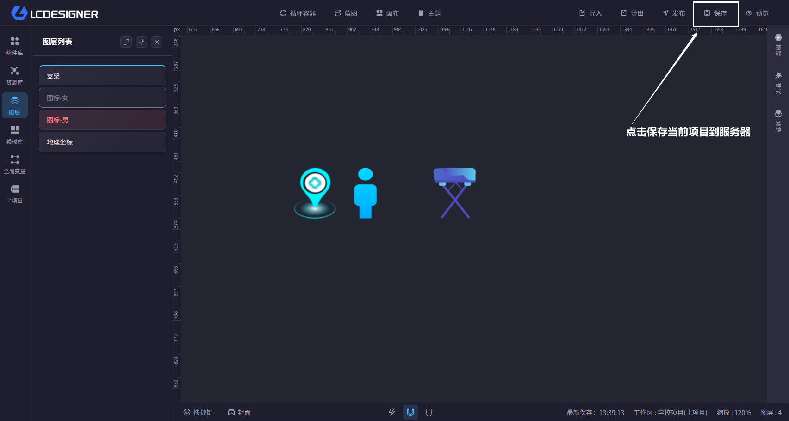

# 保存

## 总览

主设计器右上角的保存按钮和 `Ctrl+S` 都可以保存当前项目。保存后，项目数据会同步到服务器，底部状态栏会显示最新保存时间。

## 手动保存

- 点击右上角的保存按钮
- 使用 `Ctrl+S` 快速保存
- 保存时底部会显示“保存中...”

## 自动保存

- 编辑器会每 5 分钟自动记录一次本地快照
- 自动快照主要用于恢复，不会替代手动保存

## 恢复快照

- 如果项目出现异常，系统可能会自动弹出恢复窗口
- 你也可以点击底部的恢复图标，查看历史快照并选择恢复
