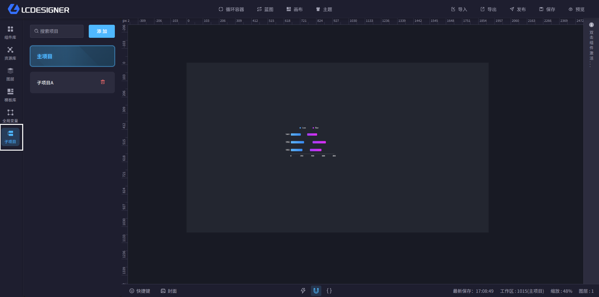
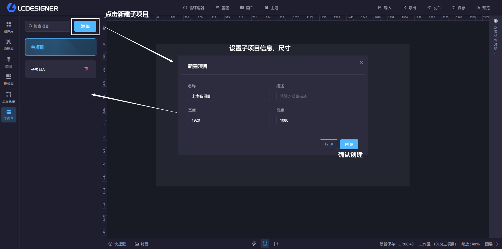
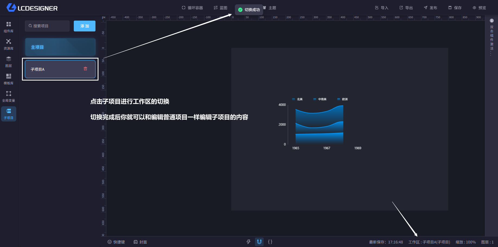
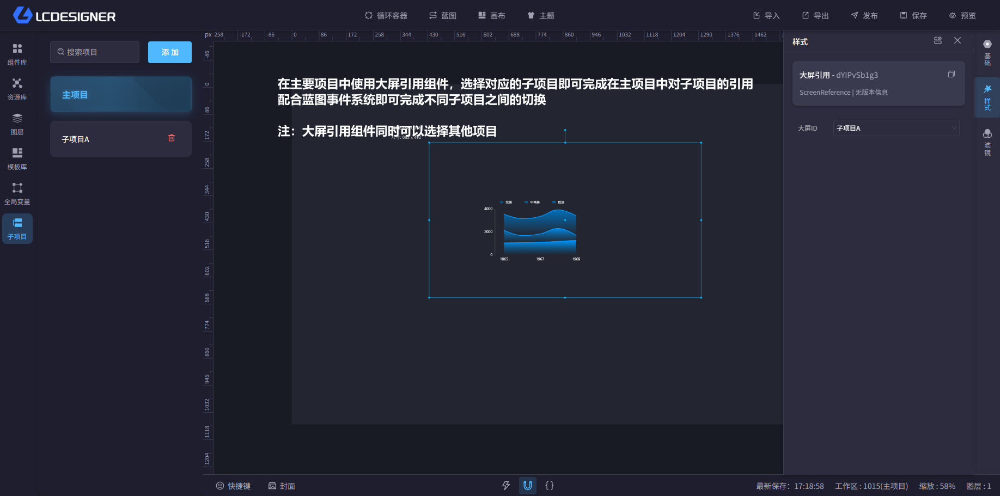

# 子项目

子项目适合把一个大项目拆成多个独立页面或场景。比如点击不同按钮切换不同展示页时，就可以把每一页拆成一个子项目来管理。相比用显示/隐藏堆在同一个画布里，子项目更清晰，也更方便维护。

## 创建子项目

?> 子项目会和当前主项目进行绑定，并且不会展示在首页的项目列表中

- 创建后会保留在当前主项目下面
- 它不会出现在首页的项目列表里

## 切换子项目

切换子项目时，系统会先保存你当前的工作内容，再加载目标子项目，避免内容丢失。

## 使用子项目

- 主项目和子项目可以来回切换
- 适合做多页面展示、分阶段编辑或局部独立设计
