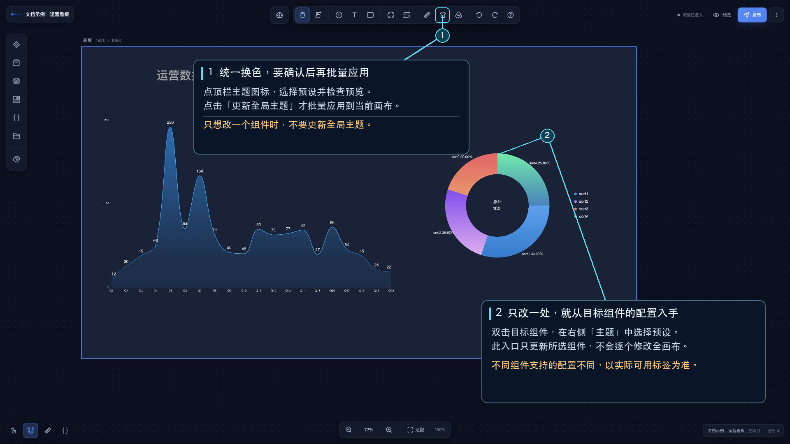

# 主题

主题提供预设配色。主设计器顶部工具栏提供全局主题入口；选中组件后，可从右侧配置区设置单组件主题。

## 全局主题

点击工具栏的主题按钮，选择主题预设并点击 **更新全局主题**。此操作会把配色应用到当前项目中支持主题的组件。

## 单组件主题

选中组件并在右侧配置区打开“主题”，选择预设即可应用到当前组件。该操作不会更新其他组件。

## 自定义主题

全局主题和单组件主题都可打开 **自定义主题**编辑器。设置主题名称和颜色后，点击 **添加 / 更新**；新增主题需要填写名称，且不能与已有主题重名。主题保存在当前项目中，可同时供全局主题和单组件主题选择。
