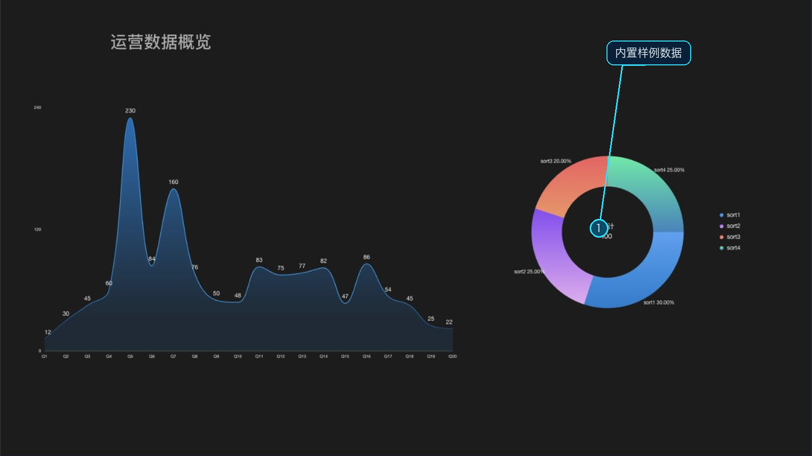

# 预览

预览以展示模式加载已保存的项目，使用画布设置中的尺寸、屏幕适配和全局滤镜渲染页面。Web 端预览会在新标签页打开；进入前设计器会先保存当前项目，保存失败时不会继续打开预览。

## 打开预览

在主设计器顶部点击 **预览**。此功能要求登录；如果登录状态失效，系统会转到登录流程。预览页面读取服务器上当前项目的已保存内容，因此它显示的是保存成功后的版本。

预览用于检查组件在展示模式中的效果。数据源、第三方资源或网络服务是否正常，仍取决于预览环境能否访问对应资源。需要分享给其他人访问时，请使用[发布](/functions/main_desiner/publish/publish.md)，而不是预览链接。
