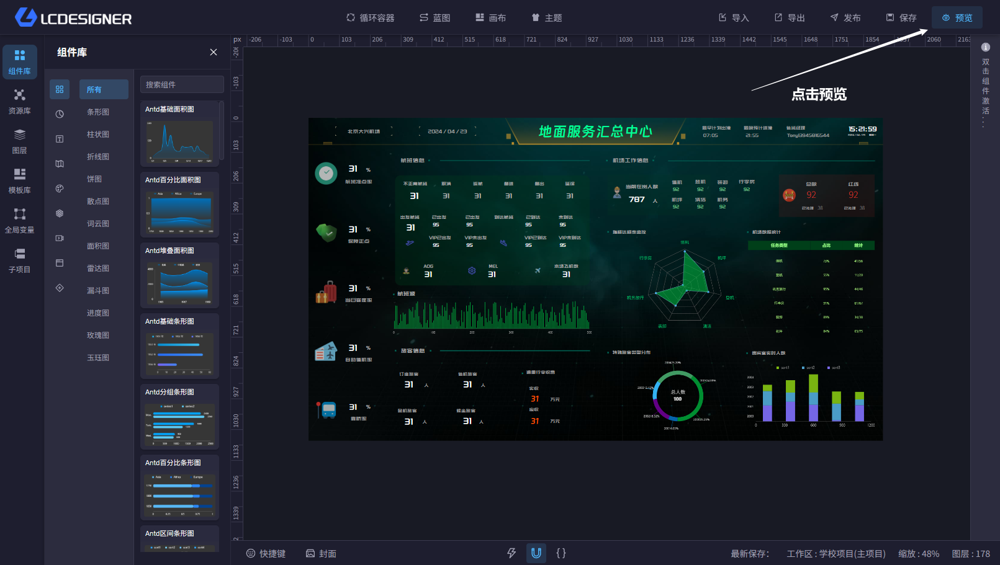

# 预览

预览功能可以快速预览当前页面。帮助用户确认当前项目的最终效果。

!> 预览功能需要用户登录后才能访问，因为它读取的是当前项目的在线页面。

## 打开方式

- 在主设计器右上角点击“预览”
- 桌面端会打开一个独立的预览窗口
- 浏览器端会在新标签页中打开预览页面

## 使用说明

- 预览的效果与画布尺寸和屏幕适配设置有关，详情可参考[画布](../canvas.md)
- 如果你刚刚修改了项目内容，建议先保存再预览，避免看到旧数据
