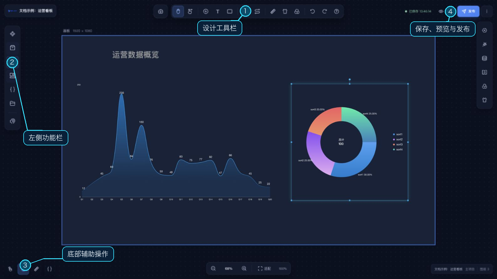

# 产品介绍

LIGHT CHASER PRO Web 端是一款在浏览器中使用的可视化设计工具，适用于数据大屏、运营看板和交互展示页面。用户通过拖放组件、配置数据和连接蓝图节点完成项目，再通过发布链接提供访问。

## 可以做什么

| 工作 | 对应能力 |
| --- | --- |
| 搭建页面 | 文本、图表、图片、视频、3D 模型、地图等组件；图层、子项目、主题与组件状态 |
| 接入数据 | 静态数据、HTTP、WebSocket、MQTT，以及首页维护的公共 API、数据库连接 |
| 配置交互 | [蓝图](/functions/blue_print/blue_print.md)节点连线、全局变量、循环容器与组件原生事件 |
| 借助 AI 编辑 | [模型管理](/functions/home/ai_model_management.md)、任务/对话、上下文设置与变更确认 |
| 管理与交付 | 项目 ZIP 导入导出、浏览器预览、发布记录、访问有效期与密码 |
| 扩展组件 | 使用 [组件开发工具](/develop/develop_pro.md)构建模块，在服务器组件中上传并供项目使用 |

## 使用入口

- **控制台**：查看项目、资源、发布记录和最近更新。
- **项目列表**：创建、编辑、复制、预览和设置项目。
- **主设计器**：编排画布、配置组件及数据、使用 AI 和蓝图。
- **发布管理**：管理已发布版本及其访问配置。

菜单与操作权限由账号角色决定，**用户管理**仅对系统管理员开放。模型、数据库和资源需由使用者按实际环境配置，空列表不代表系统已自动配置这些服务。

## 文档适用范围

本次功能说明核对的是 Web 工程 `2026.9.0`（2026-10-18），版本号来自工程声明，不代表对外最新发行包的确认。页面截图为当前 Web 界面，示例图表使用样例数据。

桌面端与独立运行时文档保留供对应交付方式查阅；它们的安装、更新和本地文件行为不能直接套用到 Web 端。第一次使用可从 [快速开始](/quick_start/quick_start.md)阅读；维护站点可看 [Web 部署](/deploy/web.md)与 [升级指南](/upgrade/upgrade.md)。
