?> 您可以在 [LCP体验站](http://www.lcdesigner.cn/home/server) 体验 LIGHT CHASER PRO 的完整功能。

本章节将介绍使用 LIGHT CHASER PRO 制作一个数据看板的整体流程。

## 创建项目

先从首页新建一个项目，再进入主设计器开始编辑。

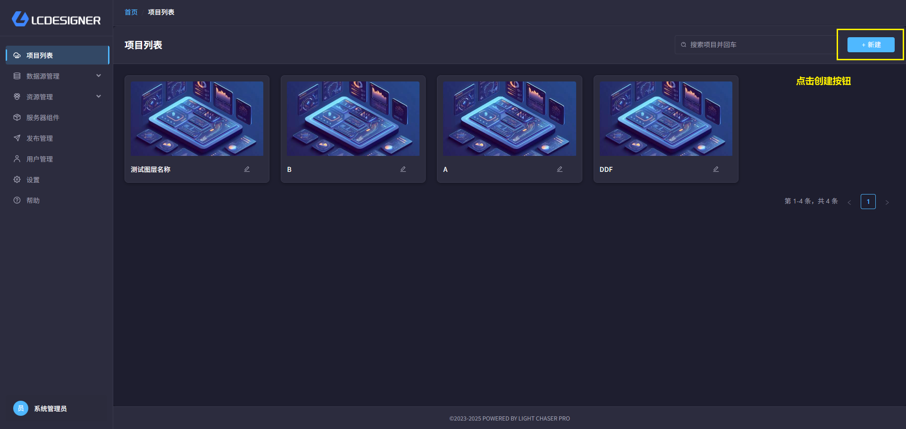

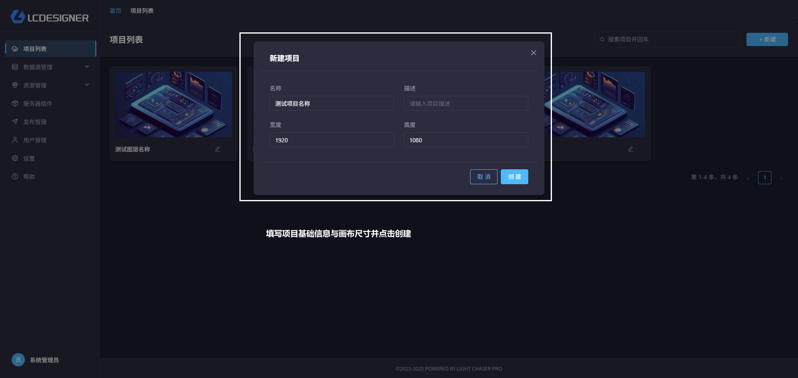

## 设计页面

在主工作区中拖拽组件、调整画布，并完成页面布局。

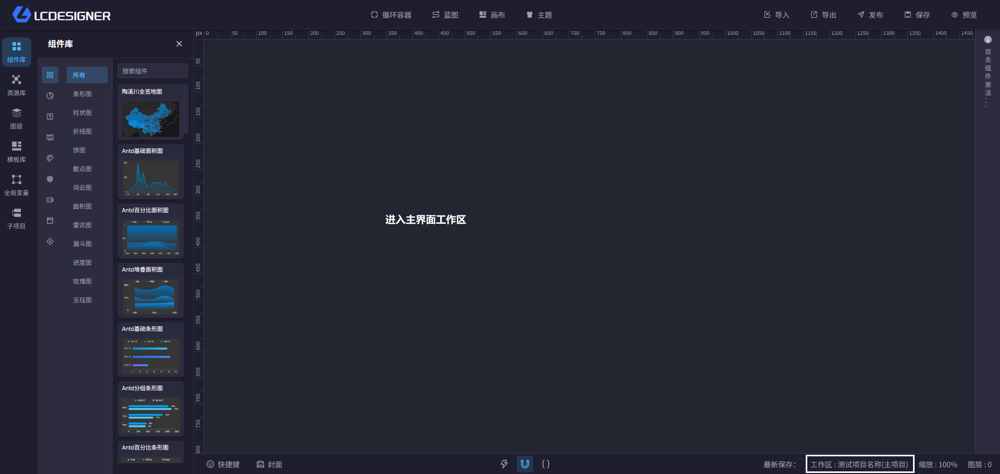

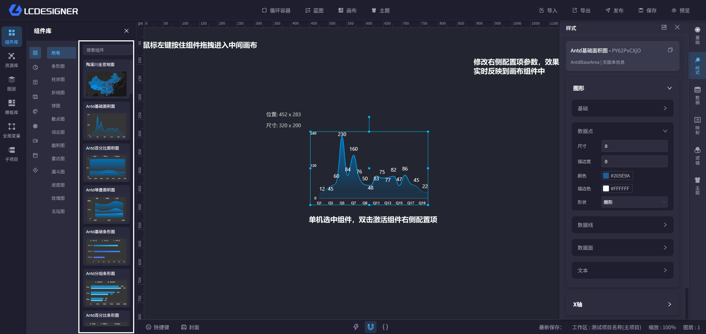

## 连接数据

通过数据源管理为组件准备数据，然后在组件配置里选择对应数据源。

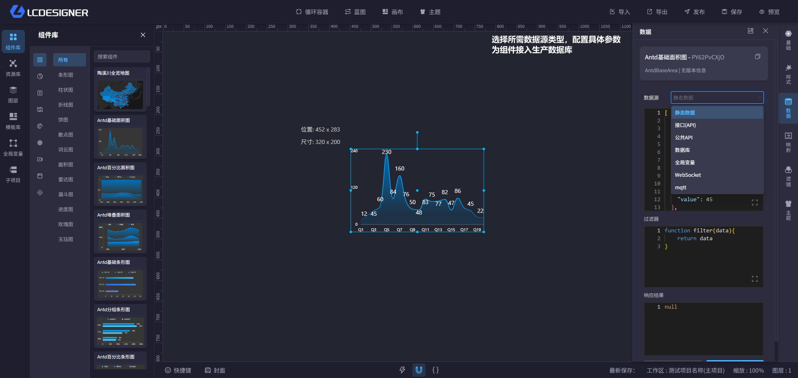

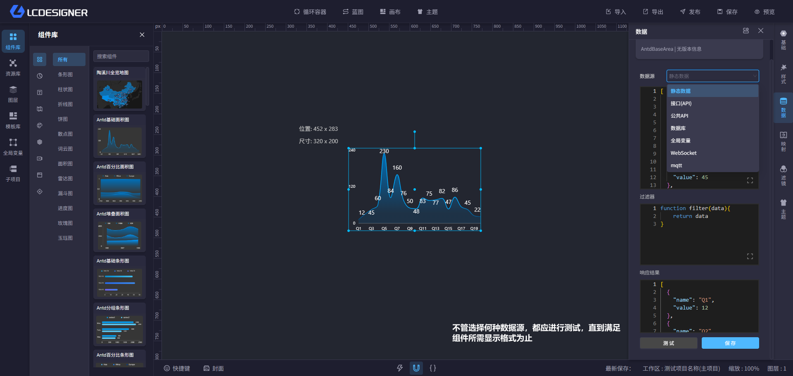

## 事件交互

打开蓝图后，你可以通过节点和连线设置页面联动逻辑。

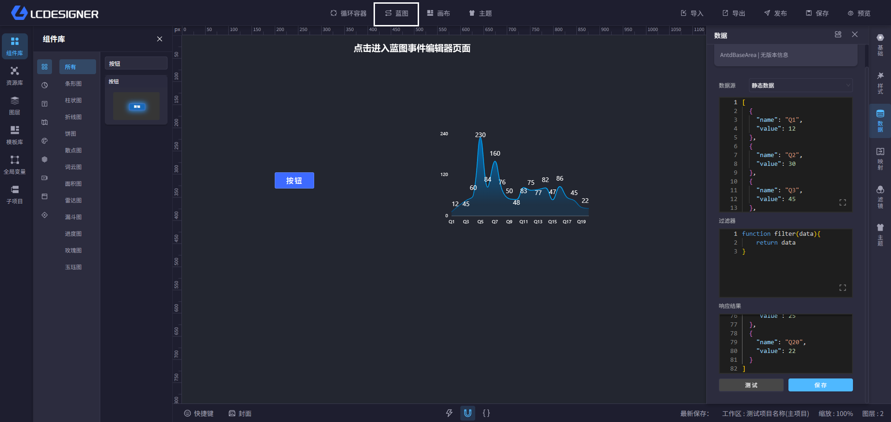

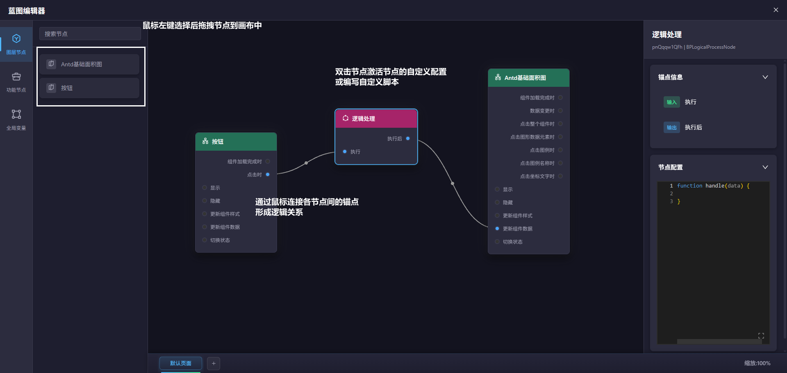

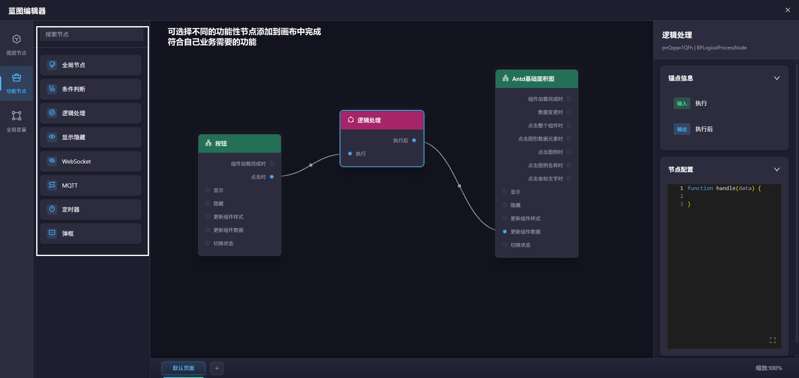

## 预览发布

确认页面样式后，先保存，再检查预览效果，最后发布给访问者使用。

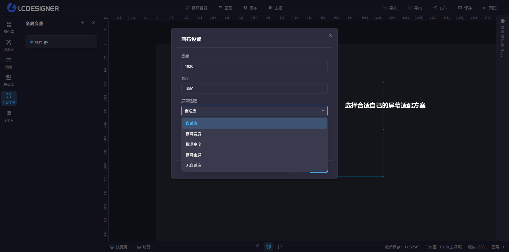

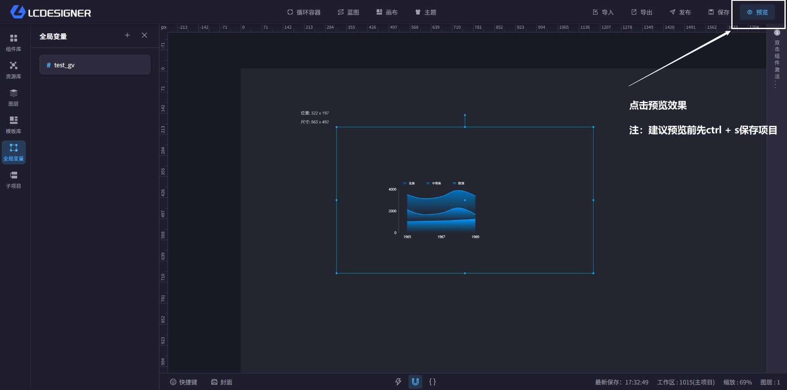
