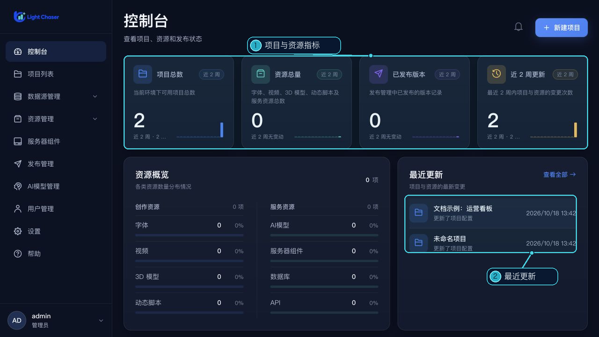
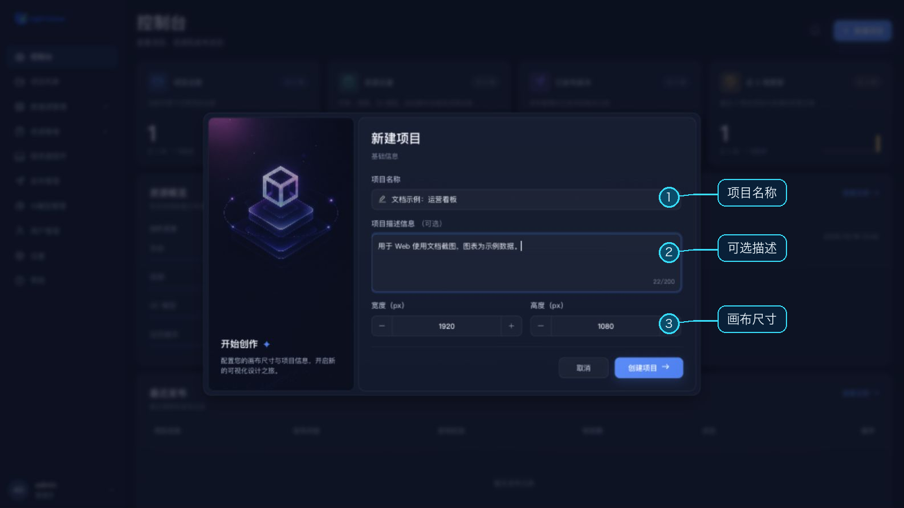
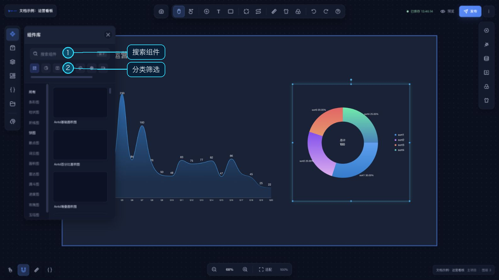
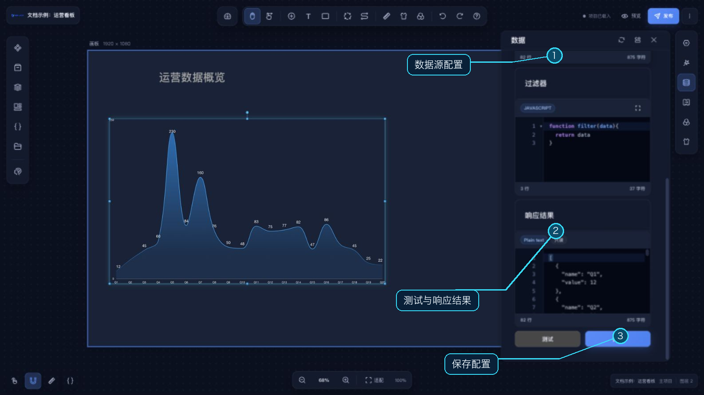
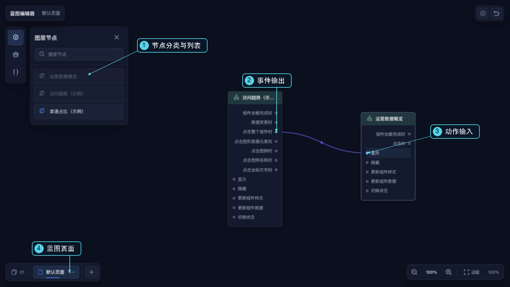
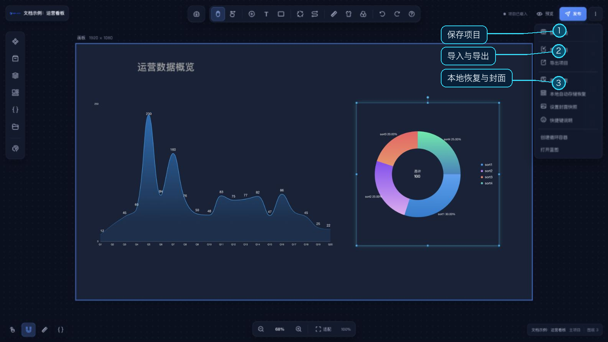
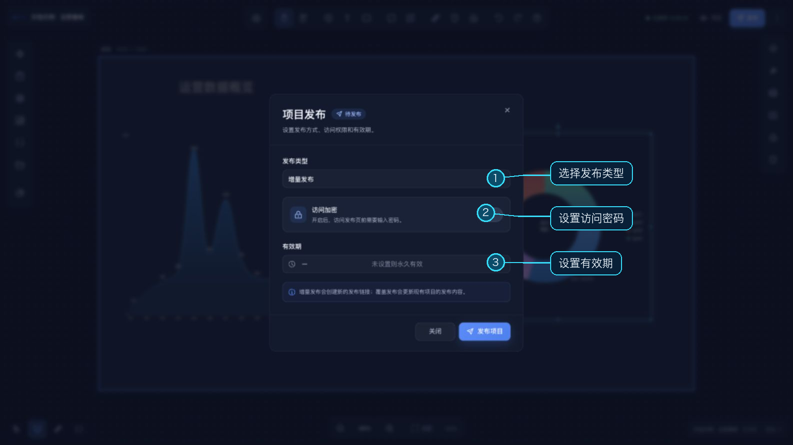

# 快速开始

本章以 Web 端为例，完成“登录 → 创建项目 → 添加组件 → 配置数据 → 预览发布”。先准备管理员提供的站点地址和账号；如尚未部署，查看 [Web 端部署](/deploy/web.md)。

## 1. 登录与创建项目

在浏览器打开站点，使用分配的账号登录。登录后进入控制台；点击右上角 **新建项目**，也可以从左侧 **项目列表**进入创建。

填写项目名称、可选描述和画布尺寸。默认画布为 **1920 × 1080**，宽高均不能小于 300。点击 **创建项目**后进入设计器。

## 2. 添加与摆放组件

打开左侧 **组件库**，按分类或名称找到图表，再拖到画布。顶栏还可以直接添加基础文本、基础色块。

单击组件后可以拖动、缩放；双击组件打开右侧配置面板。在 **基础**中调整名称、宽高与坐标，在 **样式**中配置文字、图形等外观。右侧可用标签会随组件变化。

示例画面中的标题、面积图和饼图使用内置样例数据，不代表真实业务指标。

## 3. 先用静态数据，再连接业务数据

选中图表，打开右侧 **数据**。先用默认静态数据，点击 **测试**检查响应结果；修改过静态值或过滤器后，再点击数据面板内的 **保存**。未修改时点击保存会提示“数据无变化”。图表字段与返回数据不一致时，到组件支持的 **映射**中选择对应字段。

接入业务数据时，根据需求选择 HTTP、WebSocket、MQTT、公共 API 或数据库等数据源。公共 API 与数据库连接需要先在首页 [数据源管理](/functions/home/datasource_management.md) 中维护。不同组件支持的数据形状不同，例如图表通常需要数组，不能直接把任意接口响应当作图表数据。

## 4. 按需配置交互

需要“点击一个组件，更新另一个组件”时，打开顶栏 **蓝图**。把组件节点拖入画布，将事件输出连到目标动作输入；复杂处理可以插入功能节点。具体步骤见 [蓝图使用流程](/functions/blue_print/use_flow.md)。

需要 AI 协助时，先在首页配置可用模型，再打开设计器左侧 **AI驱动**。模型设置、任务步骤和变更确认见 [AI 驱动](/functions/main_desiner/ai_fusion.md)。

## 5. 保存、预览与发布

从右上角 **更多项目操作 → 保存项目**保存到服务器，也可使用快捷键列表里的“保存项目”。顶部会显示最近保存状态。浏览器的自动快照是本地恢复手段，不等同于服务端保存。

点击 **预览**会先保存项目，再在新标签页打开预览；如果未打开，请检查浏览器是否拦截新标签页。确认图表、数据和交互后，点击 **发布**，选择发布方式，并按需填写有效期与访问密码。

发布后到首页 **发布管理**查看记录、访问地址和发布状态。编辑中的项目与已发布内容的关系，见 [发布说明](/functions/main_desiner/publish/publish.md)。
